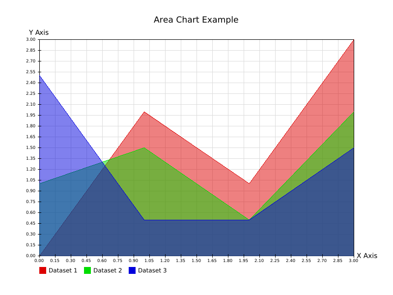
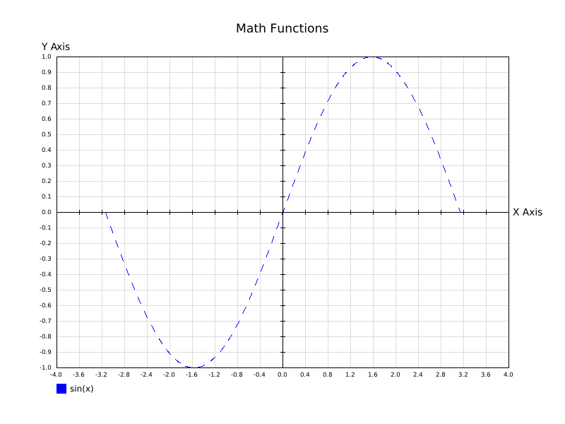
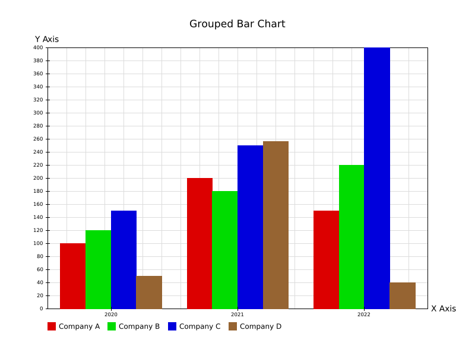
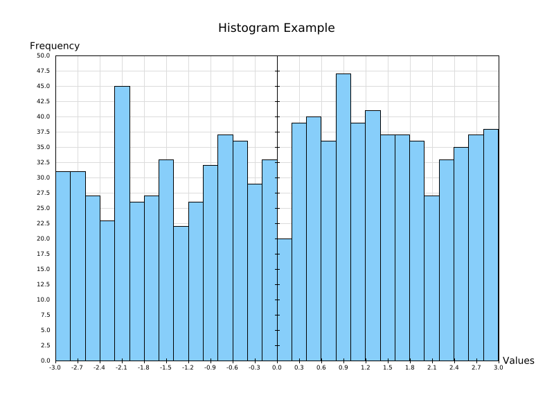
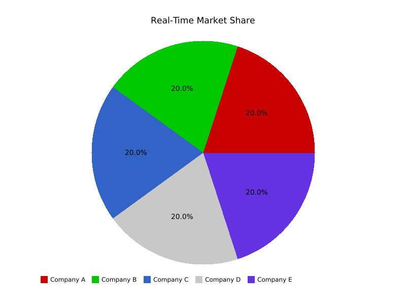
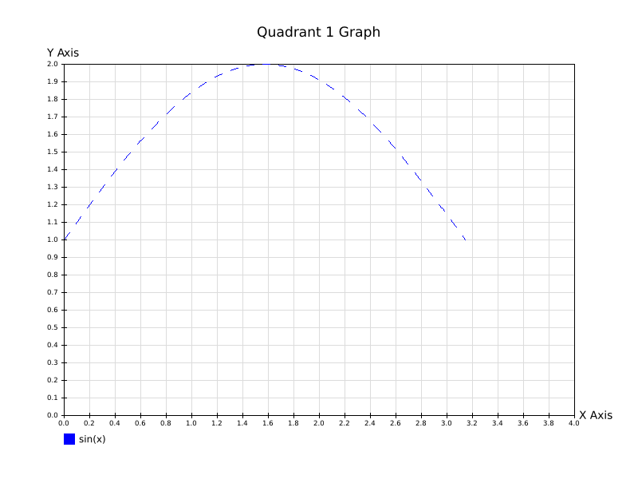
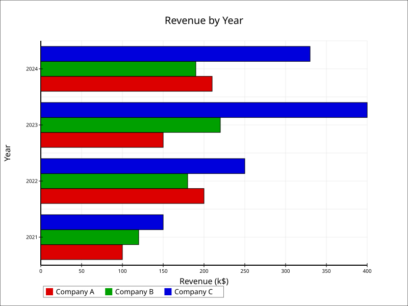
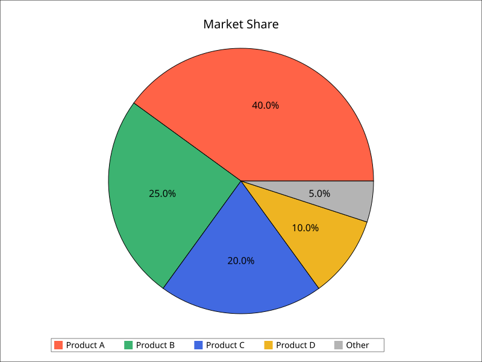
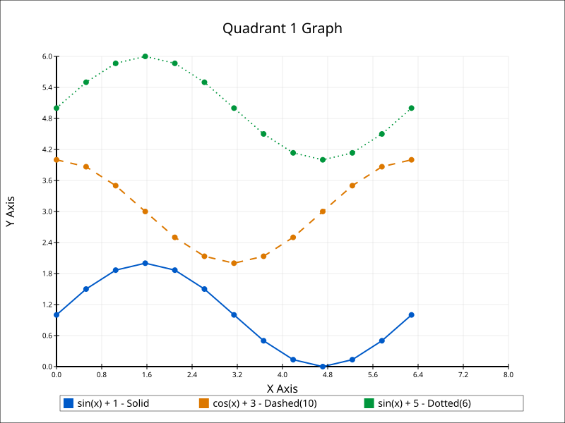

# dataviz examples

Runnable examples for [dataviz](https://github.com/dataviz-rs/dataviz)
([crates.io](https://crates.io/crates/dataviz), [docs](https://docs.rs/dataviz)),
a Rust library for bar, line, scatter, area, pie and histogram charts with PNG
and SVG output and interactive windows.

## Running an example

```sh
git clone https://github.com/dataviz-rs/dataviz-examples.git
cd dataviz-examples/svgquadrant1graph
cargo run
```

Every example writes its output (PNG or SVG) to the current directory; the
`*display` examples also open a window (`C`: hover tooltip, `H`: key hints,
`Esc`: next window / quit). No font file is needed: an installed sans-serif
font is used unless `FigureConfig::font_label` / `font_title` point to one.

The repository is a Cargo workspace, so `cargo build --workspace` builds all
of them at once.

Linux needs the usual windowing libraries for the display examples, e.g.
`sudo apt-get install libxkbcommon-dev libwayland-dev`.

## Examples

| Example | What it shows | Output |
|---|---|---|
| [`pixelareachart`](pixelareachart) | Area chart → PNG |  |
| [`pixelareachartdisplay`](pixelareachartdisplay) | Area chart in an interactive / real-time window |  |
| [`pixelcartesiangraph`](pixelcartesiangraph) | Cartesian graph (solid, dashed, dotted lines) → PNG |  |
| [`pixelcartesiandisplay`](pixelcartesiandisplay) | Cartesian graph in an interactive / real-time window |  |
| [`pixelgroupedbarchartvertical`](pixelgroupedbarchartvertical) | Grouped vertical bar chart → PNG |  |
| [`pixelgroupedbarcharthorizontal`](pixelgroupedbarcharthorizontal) | Grouped horizontal bar chart → PNG |  |
| [`pixelgroupedbarchartfigurefactory`](pixelgroupedbarchartfigurefactory) | Bar chart created with `FigureFactory` → PNG |  |
| [`pixelgroupedbarchartdisplay`](pixelgroupedbarchartdisplay) | Grouped bar chart in an interactive / real-time window |  |
| [`pixelhistogram`](pixelhistogram) | Histogram → PNG |  |
| [`pixelhistogramdisplay`](pixelhistogramdisplay) | Histogram in an interactive / real-time window |  |
| [`pixelpiechartdisplay`](pixelpiechartdisplay) | Pie chart → PNG + real-time window |  |
| [`pixelquadrant1graphdisplay`](pixelquadrant1graphdisplay) | Quadrant 1 graph in an interactive / real-time window |  |
| [`pixelscattergraphdisplay`](pixelscattergraphdisplay) | Scatter graph → PNG + real-time window |  |
| [`svgareachart`](svgareachart) | Area chart → SVG |  |
| [`svgcartesiangraph`](svgcartesiangraph) | Cartesian graph → SVG |  |
| [`svggroupedbarchartvertical`](svggroupedbarchartvertical) | Grouped vertical bar chart → SVG |  |
| [`svggroupedbarcharthorizontal`](svggroupedbarcharthorizontal) | Grouped horizontal bar chart → SVG |  |
| [`svghistogram`](svghistogram) | Histogram → SVG |  |
| [`svgpiechart`](svgpiechart) | Pie chart → SVG |  |
| [`svgquadrant1graph`](svgquadrant1graph) | Quadrant 1 graph, all line styles, data-point markers → SVG |  |
| [`svgscattergraph`](svgscattergraph) | Scatter graph with every dot type → SVG |  |

## License

MIT, see [LICENSE](LICENSE).
