# dataviz examples

Runnable examples for [dataviz](https://github.com/dataviz-rs/dataviz)
([crates.io](https://crates.io/crates/dataviz), [docs](https://docs.rs/dataviz)),
a pure-Rust plotting library with 40+ chart types, SVG/PNG/JPEG/WebP/PDF
output, interactive windows and terminal output.

## Running an example

```sh
git clone https://github.com/dataviz-rs/dataviz-examples.git
cd dataviz-examples/plot-bars
cargo run --release
```

Every example writes its output (PNG and/or SVG) to the current directory;
the `screenshots/` folder of each example contains that output. The
`*display` and `plot-interactive` examples also open a window. No font file is
needed: an installed sans-serif font is used by default.

The repository is a Cargo workspace, so `cargo build --workspace` builds all
of them at once. Until dataviz 0.2 is published on crates.io, the workspace
builds dataviz from its `main` branch (see `[patch.crates-io]` in
`Cargo.toml`).

Linux needs the usual windowing libraries for the window examples, e.g.
`sudo apt-get install libxkbcommon-dev libwayland-dev`.

## Plot API examples (`dataviz::plot`, 0.2)

| Example | What it shows | Output |
|---|---|---|
| [`plot-line`](plot-line) | Line styles | 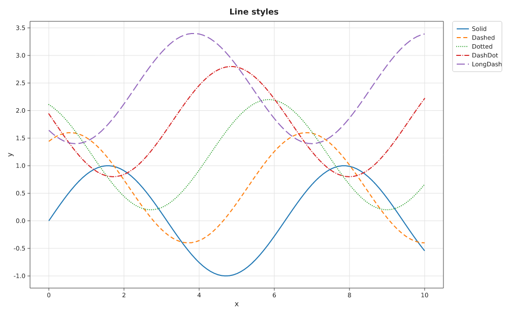 |
| [`plot-markers-steps-smooth`](plot-markers-steps-smooth) | Markers, steps and smoothing |  |
| [`plot-area-fill`](plot-area-fill) | Area and fill between | 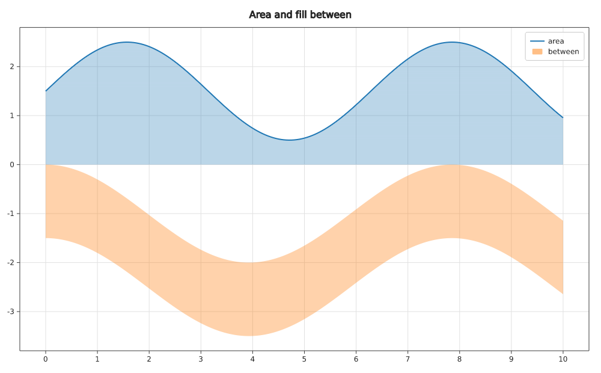 |
| [`plot-stacked-area`](plot-stacked-area) | Stacked areas | 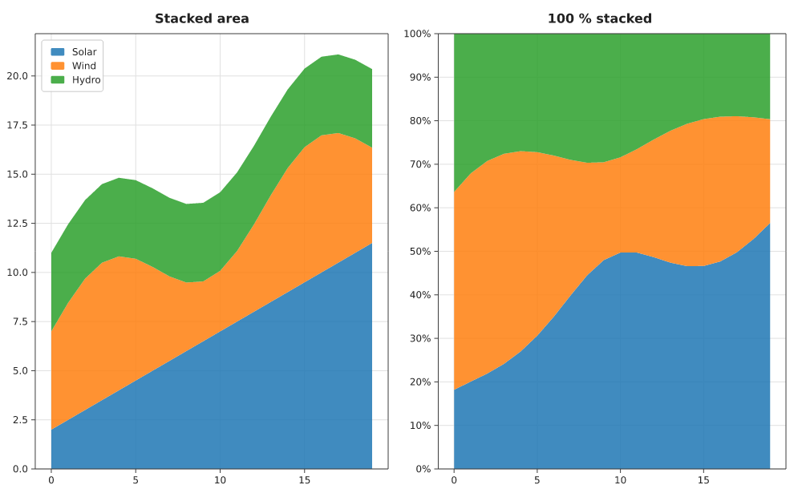 |
| [`plot-scatter-bubble`](plot-scatter-bubble) | Scatter and bubble charts |  |
| [`plot-bars`](plot-bars) | Bar charts |  |
| [`plot-histograms`](plot-histograms) | Histograms, KDE and ECDF | 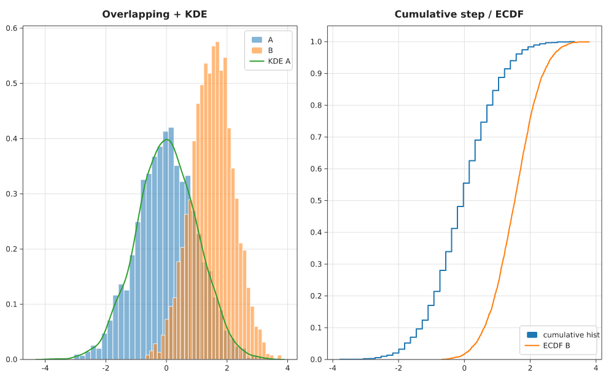 |
| [`plot-box-violin`](plot-box-violin) | Box and violin plots |  |
| [`plot-errorbars-band`](plot-errorbars-band) | Error bars and confidence bands | 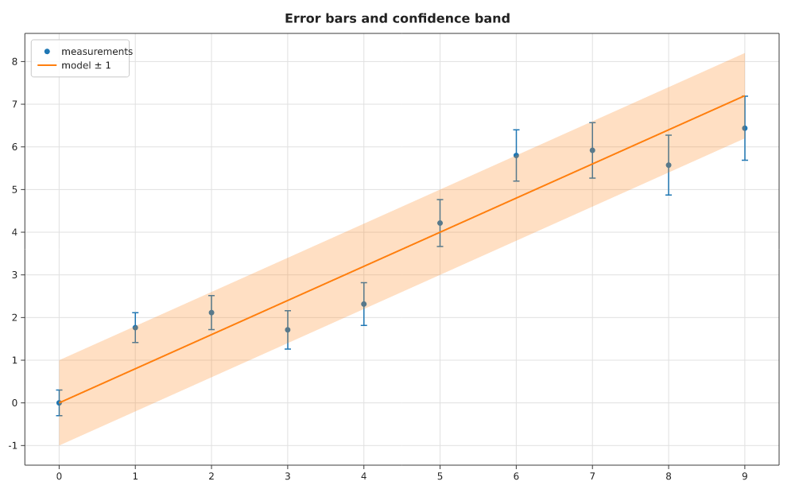 |
| [`plot-heatmap`](plot-heatmap) | Heatmap (correlation matrix) |  |
| [`plot-hist2d-hexbin`](plot-hist2d-hexbin) | 2D histogram and hexbin |  |
| [`plot-contour`](plot-contour) | Contour plots | 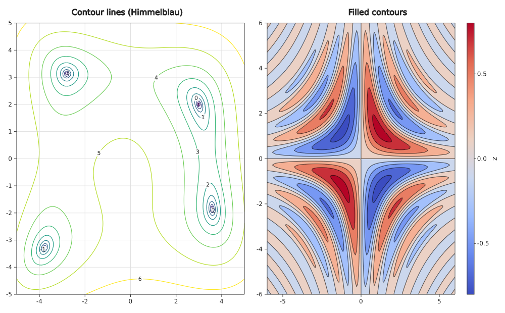 |
| [`plot-candlestick`](plot-candlestick) | Candlestick chart | 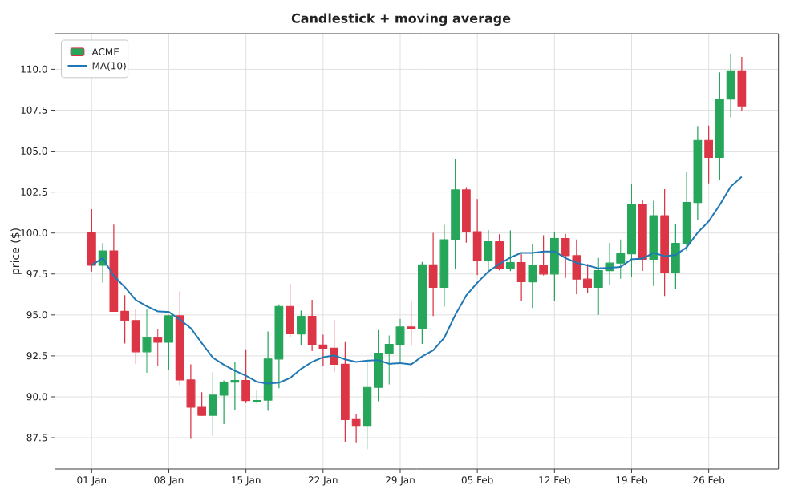 |
| [`plot-time-series`](plot-time-series) | Time series |  |
| [`plot-log-scales`](plot-log-scales) | Logarithmic scales |  |
| [`plot-formats`](plot-formats) | Tick formats |  |
| [`plot-stem-waterfall`](plot-stem-waterfall) | Stem and waterfall charts |  |
| [`plot-quiver-function`](plot-quiver-function) | Vector field and function plots |  |
| [`plot-gantt`](plot-gantt) | Gantt chart |  |
| [`plot-pie-donut`](plot-pie-donut) | Pie and donut charts |  |
| [`plot-polar-radar`](plot-polar-radar) | Polar, radar and rose charts |  |
| [`plot-treemap-sunburst`](plot-treemap-sunburst) | Treemap and sunburst |  |
| [`plot-sankey`](plot-sankey) | Sankey diagram |  |
| [`plot-funnel-gauge`](plot-funnel-gauge) | Funnel and gauge | 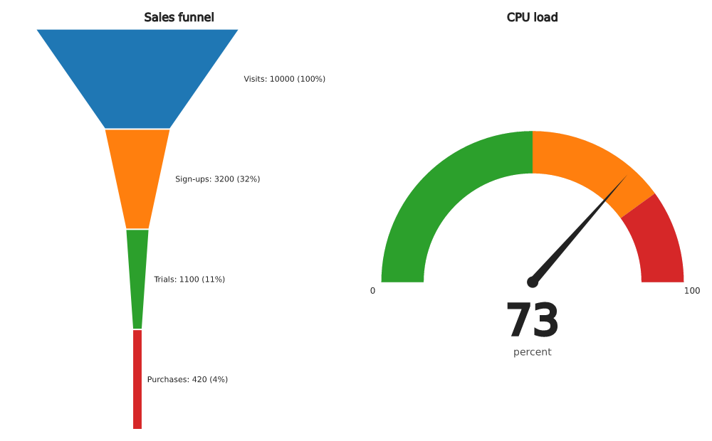 |
| [`plot-network`](plot-network) | Network graph |  |
| [`plot-parallel-calendar`](plot-parallel-calendar) | Parallel coordinates and calendar heatmap | 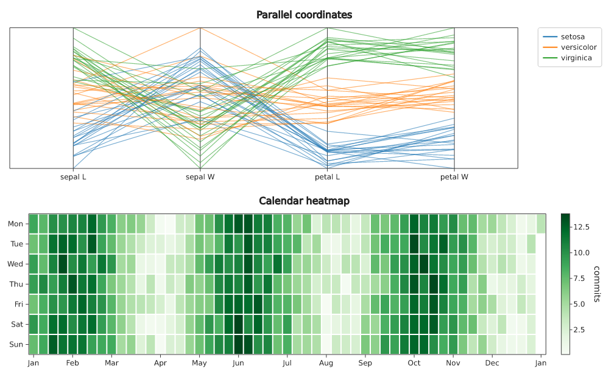 |
| [`plot-three-d`](plot-three-d) | 3D surface and trajectory |  |
| [`plot-subplots-shared`](plot-subplots-shared) | Subplots with a shared x-axis |  |
| [`plot-annotations`](plot-annotations) | Annotations | 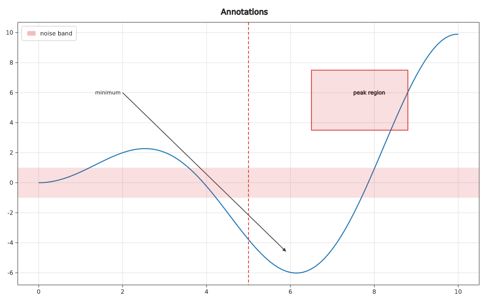 |
| [`plot-image`](plot-image) | Image display |  |
| [`plot-themes`](plot-themes) | Every built-in theme |  |
| [`plot-interactive`](plot-interactive) | Interactive window (zoom, pan, hover) and live data |  |
| [`plot-terminal`](plot-terminal) | Charts in the terminal (half blocks / braille) | [terminal.txt](plot-terminal/screenshots/terminal.txt) |

## Classic API examples (`dataviz::figure`)


| Example | What it shows | Output |
|---|---|---|
| [`pixelareachart`](pixelareachart) | Area chart → PNG |  |
| [`pixelareachartdisplay`](pixelareachartdisplay) | Area chart in an interactive / real-time window |  |
| [`pixelcartesiangraph`](pixelcartesiangraph) | Cartesian graph (solid, dashed, dotted lines) → PNG | 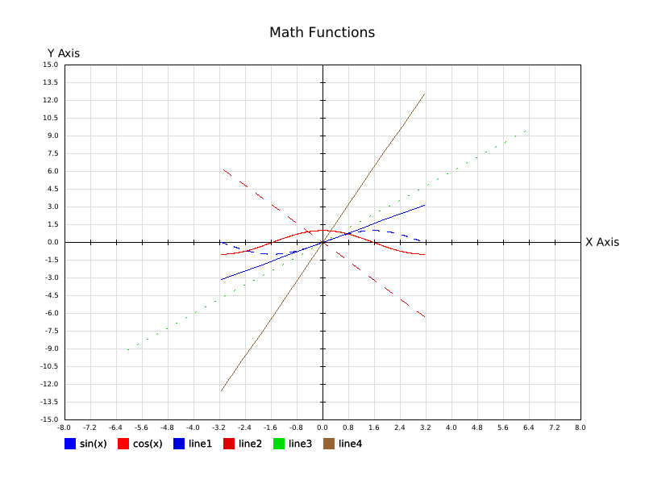 |
| [`pixelcartesiandisplay`](pixelcartesiandisplay) | Cartesian graph in an interactive / real-time window |  |
| [`pixelgroupedbarchartvertical`](pixelgroupedbarchartvertical) | Grouped vertical bar chart → PNG |  |
| [`pixelgroupedbarcharthorizontal`](pixelgroupedbarcharthorizontal) | Grouped horizontal bar chart → PNG | 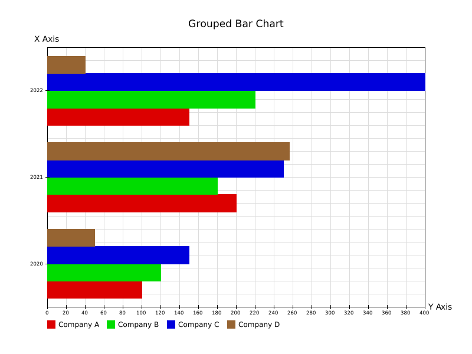 |
| [`pixelgroupedbarchartfigurefactory`](pixelgroupedbarchartfigurefactory) | Bar chart created with `FigureFactory` → PNG | 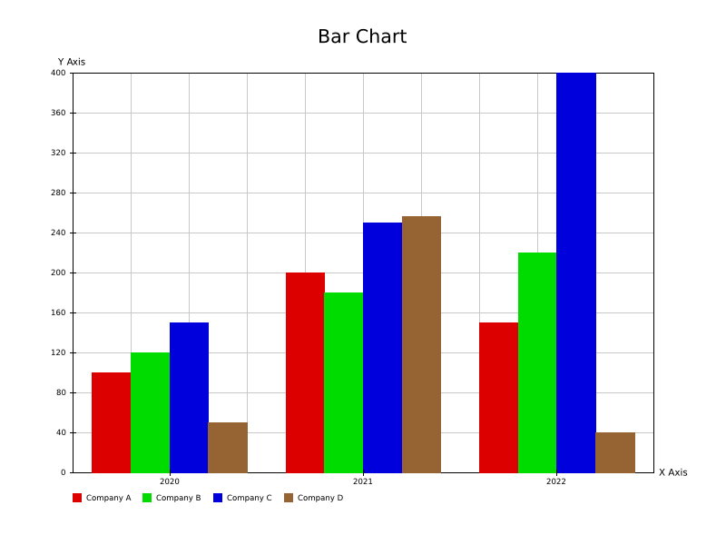 |
| [`pixelgroupedbarchartdisplay`](pixelgroupedbarchartdisplay) | Grouped bar chart in an interactive / real-time window |  |
| [`pixelhistogram`](pixelhistogram) | Histogram → PNG |  |
| [`pixelhistogramdisplay`](pixelhistogramdisplay) | Histogram in an interactive / real-time window | 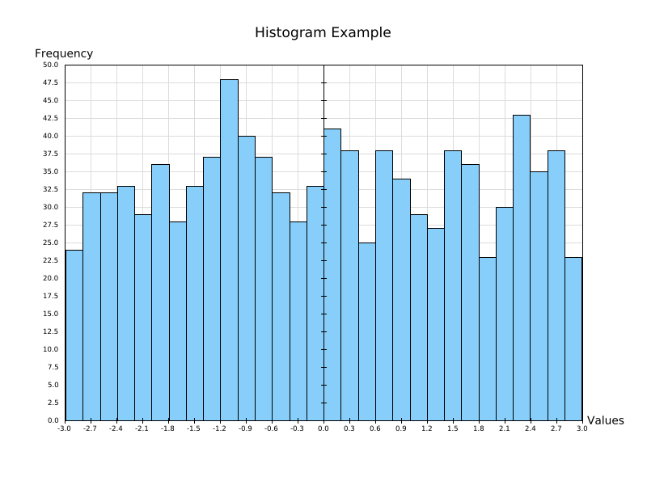 |
| [`pixelpiechartdisplay`](pixelpiechartdisplay) | Pie chart → PNG + real-time window |  |
| [`pixelquadrant1graphdisplay`](pixelquadrant1graphdisplay) | Quadrant 1 graph in an interactive / real-time window |  |
| [`pixelscattergraphdisplay`](pixelscattergraphdisplay) | Scatter graph → PNG + real-time window | 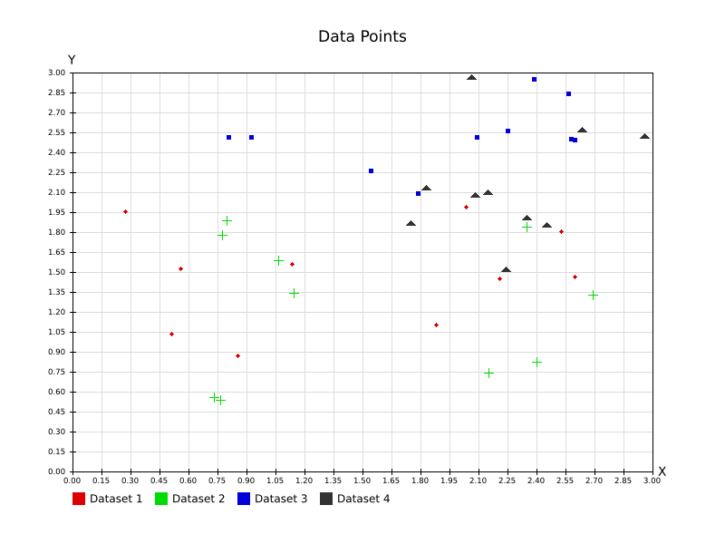 |
| [`svgareachart`](svgareachart) | Area chart → SVG | 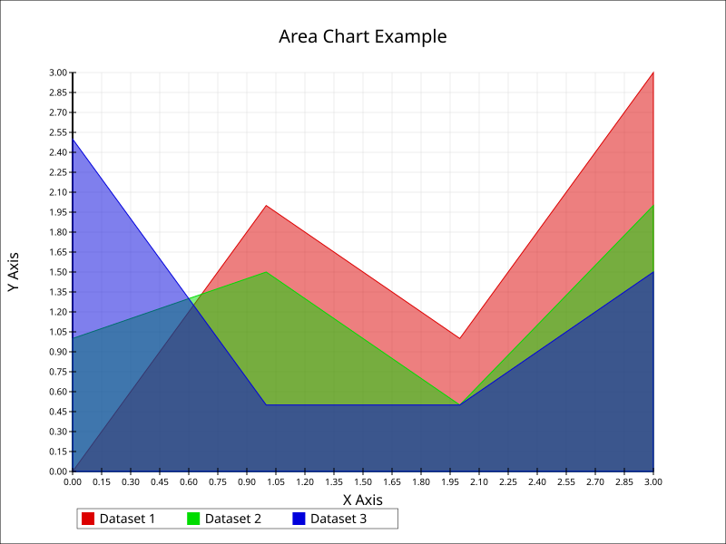 |
| [`svgcartesiangraph`](svgcartesiangraph) | Cartesian graph → SVG | 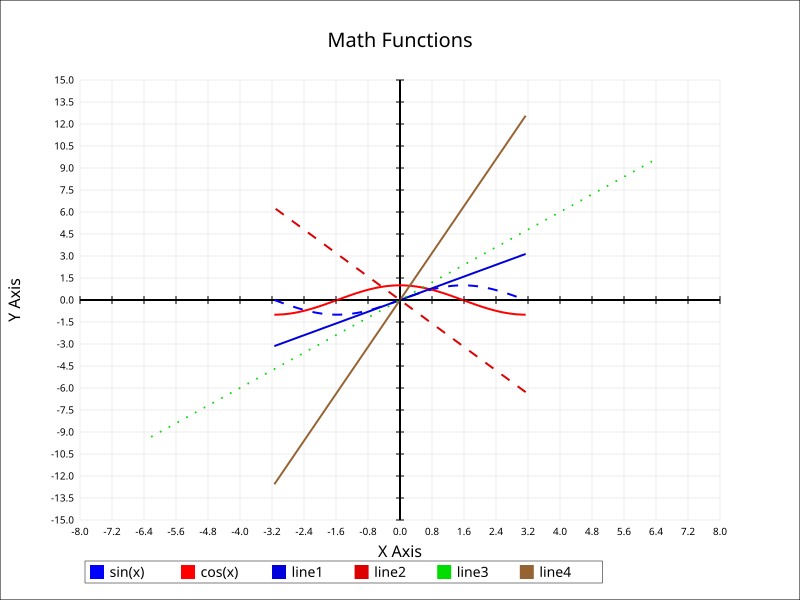 |
| [`svggroupedbarchartvertical`](svggroupedbarchartvertical) | Grouped vertical bar chart → SVG |  |
| [`svggroupedbarcharthorizontal`](svggroupedbarcharthorizontal) | Grouped horizontal bar chart → SVG |  |
| [`svghistogram`](svghistogram) | Histogram → SVG | 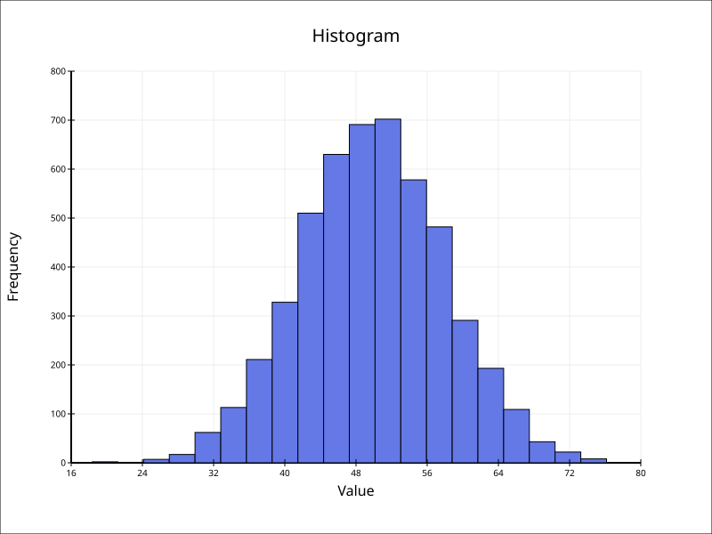 |
| [`svgpiechart`](svgpiechart) | Pie chart → SVG |  |
| [`svgquadrant1graph`](svgquadrant1graph) | Quadrant 1 graph, all line styles, data-point markers → SVG |  |
| [`svgscattergraph`](svgscattergraph) | Scatter graph with every dot type → SVG | 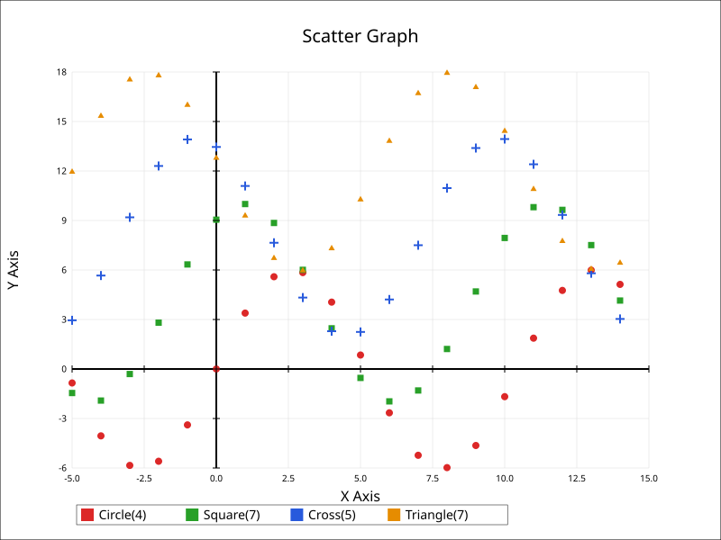 |

## License

MIT, see [LICENSE](LICENSE).
