# dataviz examples

Runnable examples for [dataviz](https://github.com/dataviz-rs/dataviz)
([crates.io](https://crates.io/crates/dataviz), [docs](https://docs.rs/dataviz)),
a pure-Rust plotting library with 40+ chart types, SVG/PNG/JPEG/WebP/PDF
output, interactive and live windows, terminal output and CPU / multi-core /
GPU rendering. The examples always use the latest dataviz release.

## Running an example

```sh
git clone https://github.com/dataviz-rs/dataviz-examples.git
cd dataviz-examples/plot-bars
cargo run --release
```

Every example writes its output (PNG and/or SVG) to the current directory;
the `screenshots/` folder of each example contains that output. The
`plot-interactive` and `plot-streaming` examples open a window
(`plot-streaming --record out.gif` works without one). No font file is needed: the
font is built into dataviz.

The repository is a Cargo workspace, so `cargo build --workspace` builds all
of them at once.

Linux needs the usual windowing libraries for the window examples, e.g.
`sudo apt-get install libxkbcommon-dev libwayland-dev`.

## Benchmarks

[`benchmarks/`](benchmarks) compares dataviz with plotters, ruviz, kuva and charts-rs
(static, big data, real time, animation); results in
[benchmarks/RESULTS.md](benchmarks/RESULTS.md), rerun with `python3 run_all.py`.

## Examples

| Example | What it shows | Output |
|---|---|---|
| [`plot-line`](plot-line) | Line styles |  |
| [`plot-markers-steps-smooth`](plot-markers-steps-smooth) | Markers, steps and smoothing | 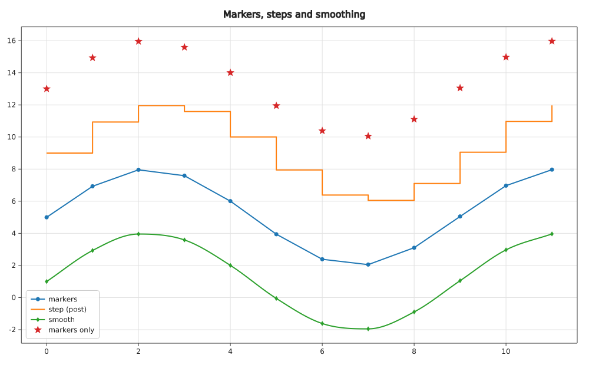 |
| [`plot-area-fill`](plot-area-fill) | Area and fill between |  |
| [`plot-stacked-area`](plot-stacked-area) | Stacked areas |  |
| [`plot-scatter-bubble`](plot-scatter-bubble) | Scatter and bubble charts |  |
| [`plot-bars`](plot-bars) | Bar charts |  |
| [`plot-histograms`](plot-histograms) | Histograms, KDE and ECDF |  |
| [`plot-box-violin`](plot-box-violin) | Box and violin plots |  |
| [`plot-distributions`](plot-distributions) | Strip, swarm, ridgeline and Q-Q plots |  |
| [`plot-facets`](plot-facets) | Small multiples and pair plots |  |
| [`plot-errorbars-band`](plot-errorbars-band) | Error bars and confidence bands |  |
| [`plot-heatmap`](plot-heatmap) | Heatmap (correlation matrix) |  |
| [`plot-hist2d-hexbin`](plot-hist2d-hexbin) | 2D histogram and hexbin |  |
| [`plot-contour`](plot-contour) | Contour plots |  |
| [`plot-data-science`](plot-data-science) | ROC/PR curves, confusion matrix, regression band, density, dendrogram | 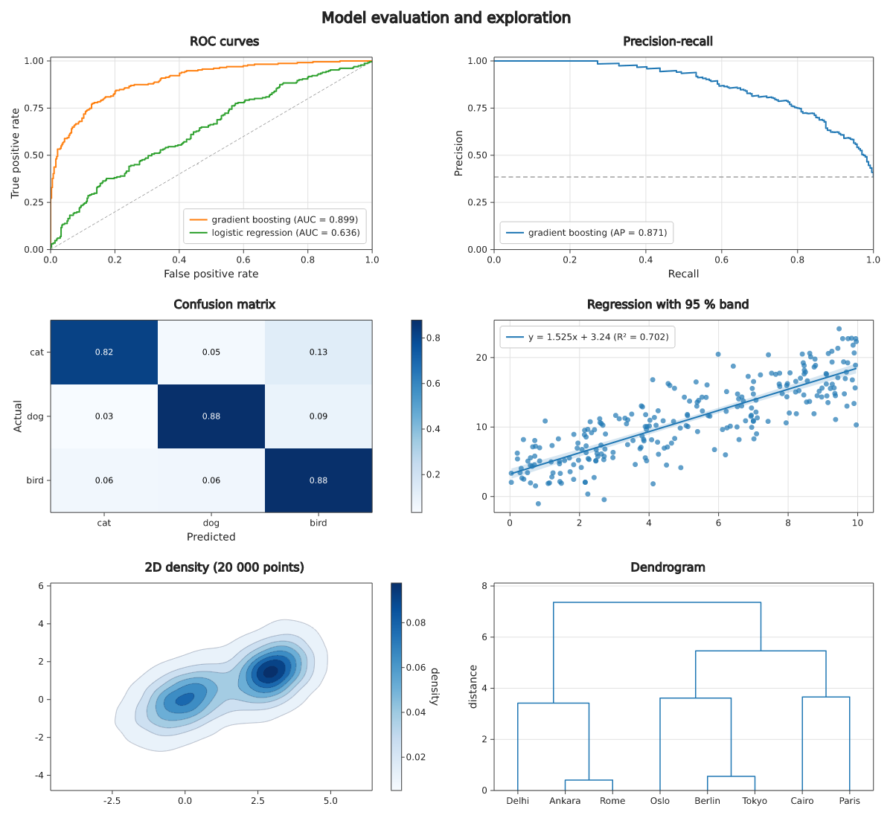 |
| [`plot-engineering`](plot-engineering) | FFT spectrum, spectrogram, Bode, Nyquist, Smith chart |  |
| [`plot-trading`](plot-trading) | Ichimoku, VWAP, volume profile, depth, stochastic, ATR, drawdown, Renko |  |
| [`plot-candlestick`](plot-candlestick) | Candlestick chart |  |
| [`plot-indicators`](plot-indicators) | Bollinger bands, RSI, MACD, Heikin-Ashi | 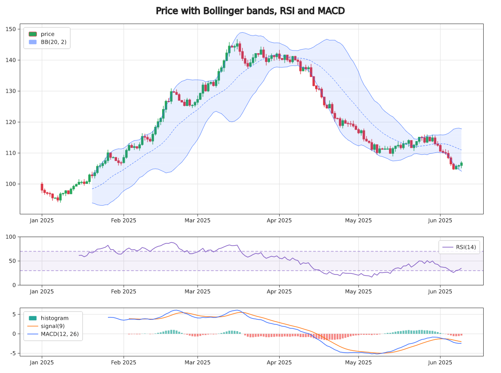 |
| [`plot-time-series`](plot-time-series) | Time series | 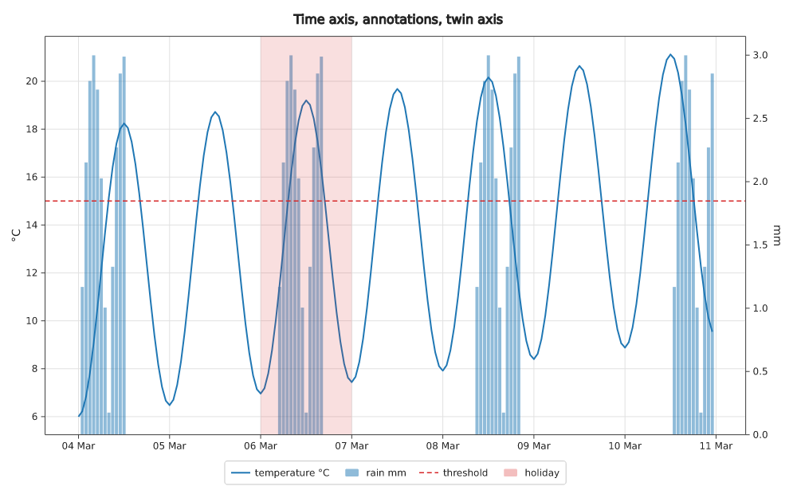 |
| [`plot-log-scales`](plot-log-scales) | Logarithmic scales | 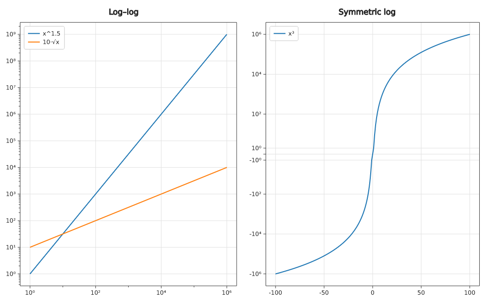 |
| [`plot-broken-axis`](plot-broken-axis) | Broken axes |  |
| [`plot-formats`](plot-formats) | Tick formats | 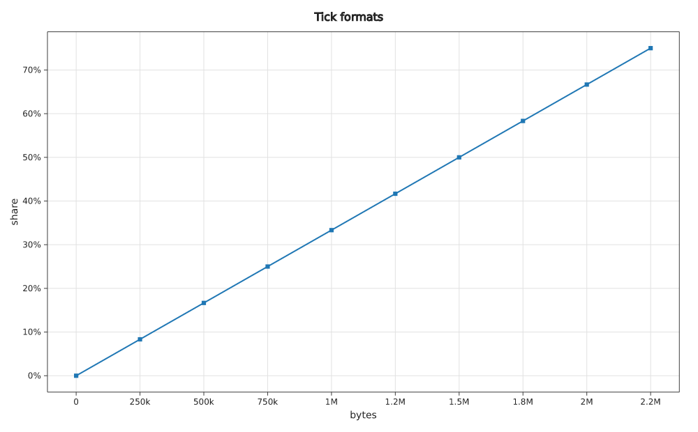 |
| [`plot-stem-waterfall`](plot-stem-waterfall) | Stem and waterfall charts | 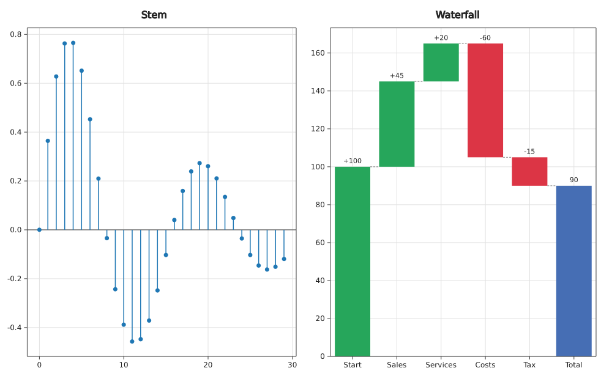 |
| [`plot-quiver-function`](plot-quiver-function) | Vector field and function plots | 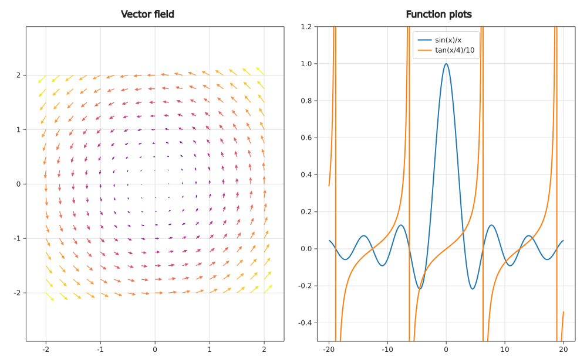 |
| [`plot-gantt`](plot-gantt) | Gantt chart | 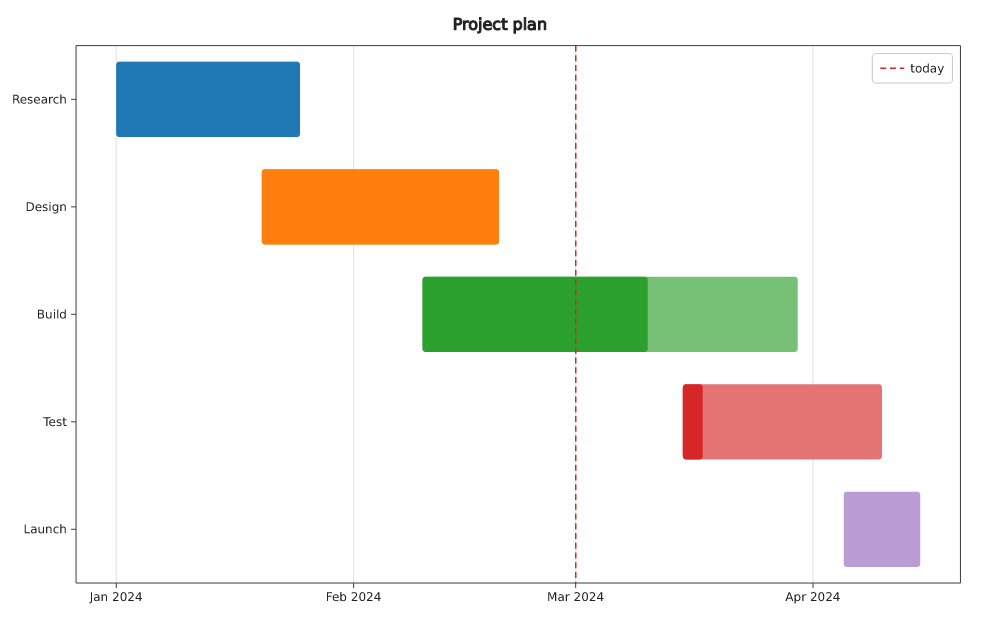 |
| [`plot-pie-donut`](plot-pie-donut) | Pie and donut charts |  |
| [`plot-polar-radar`](plot-polar-radar) | Polar, radar and rose charts |  |
| [`plot-treemap-sunburst`](plot-treemap-sunburst) | Treemap and sunburst |  |
| [`plot-maps`](plot-maps) | World choropleth, routes, projections |  |
| [`plot-sankey`](plot-sankey) | Sankey diagram | 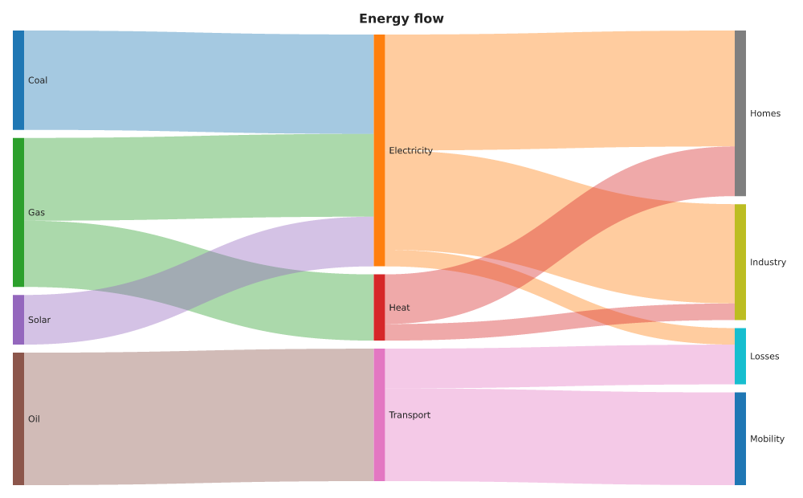 |
| [`plot-funnel-gauge`](plot-funnel-gauge) | Funnel and gauge |  |
| [`plot-network`](plot-network) | Network graph |  |
| [`plot-parallel-calendar`](plot-parallel-calendar) | Parallel coordinates and calendar heatmap |  |
| [`plot-three-d`](plot-three-d) | 3D surface and trajectory |  |
| [`plot-subplots-shared`](plot-subplots-shared) | Subplots with a shared x-axis |  |
| [`plot-annotations`](plot-annotations) | Annotations |  |
| [`plot-image`](plot-image) | Image display | 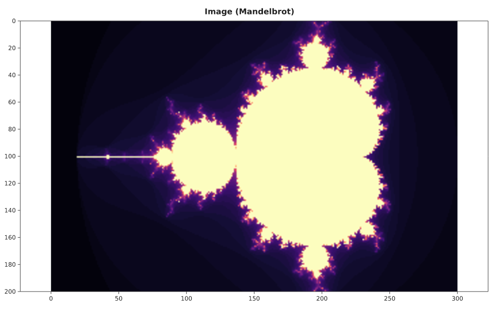 |
| [`plot-themes`](plot-themes) | Every built-in theme |  |
| [`plot-interactive`](plot-interactive) | Interactive window (zoom, pan, hover) and live data |  |
| [`plot-egui`](plot-egui) | Embedded in an egui app: texture + zoom/pan/hover API |  |
| [`plot-html`](plot-html) | Interactive HTML: hover, crosshair, legend toggle | 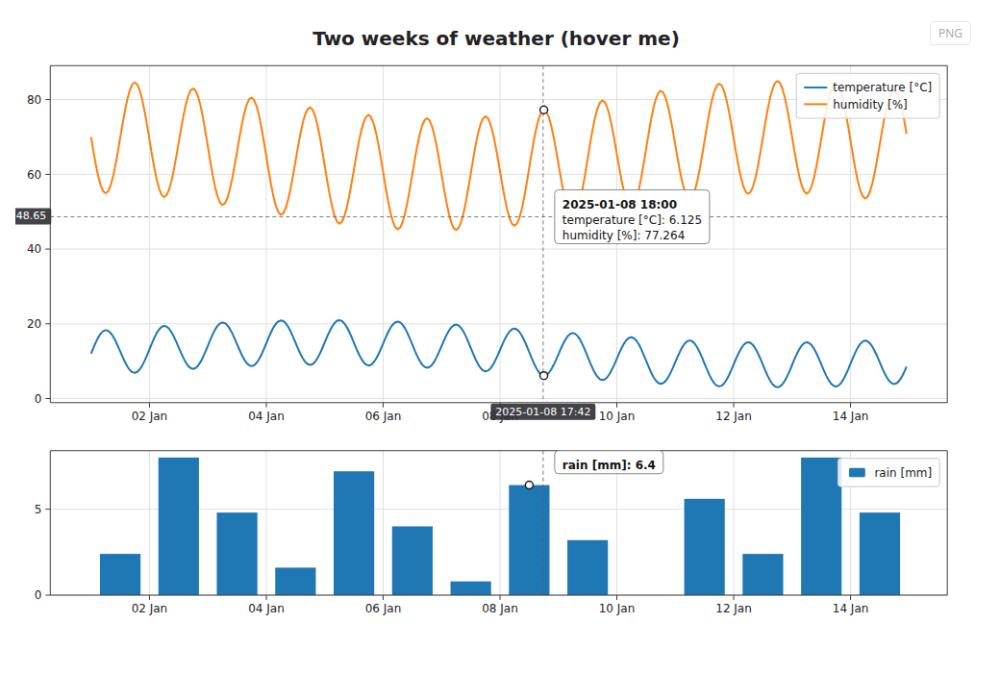 |
| [`plot-wasm`](plot-wasm) | In the browser: Rust → WebAssembly, streaming, zoom, hover | 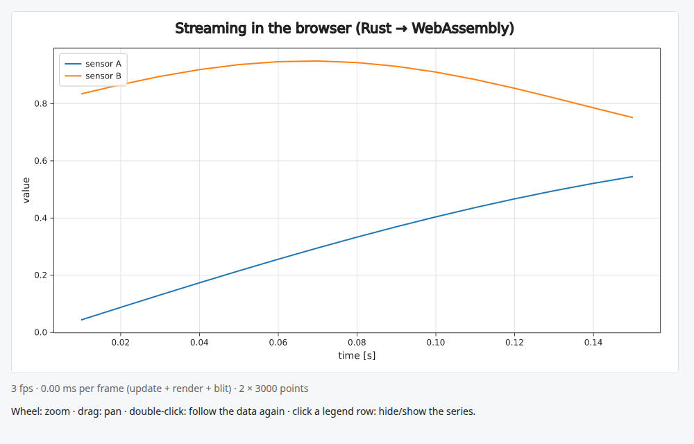 |
| [`plot-accessibility`](plot-accessibility) | Alt text, color vision simulation and checks | 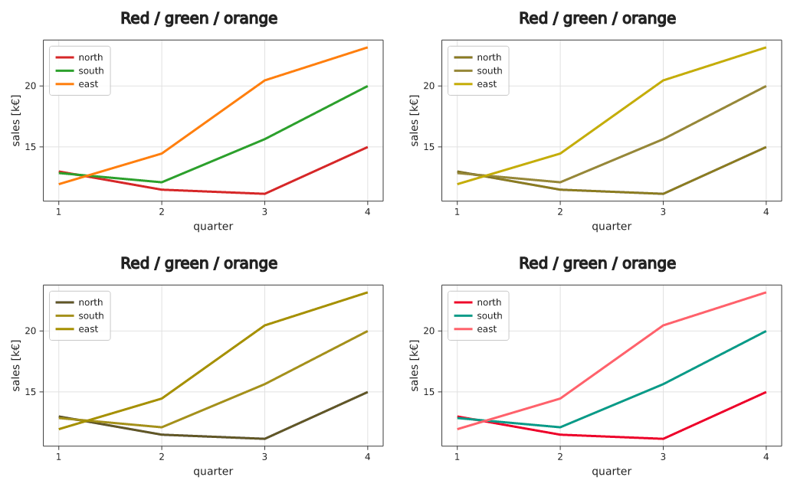 |
| [`plot-international`](plot-international) | Text in any language: CJK, Arabic, Hebrew, Hindi, Thai, emoji |  |
| [`plot-math`](plot-math) | Math notation in labels, legends and annotations |  |
| [`plot-animation`](plot-animation) | Animations: GIF and animated PNG | 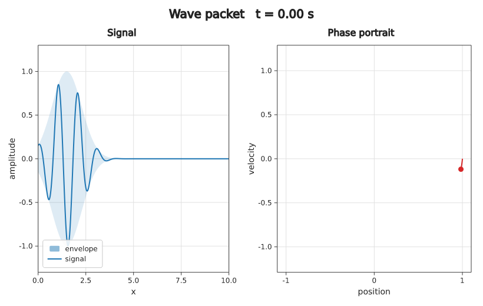 |
| [`plot-streaming`](plot-streaming) | Live dashboard for streaming data (simulated sensors, CPU/memory, stdin) | 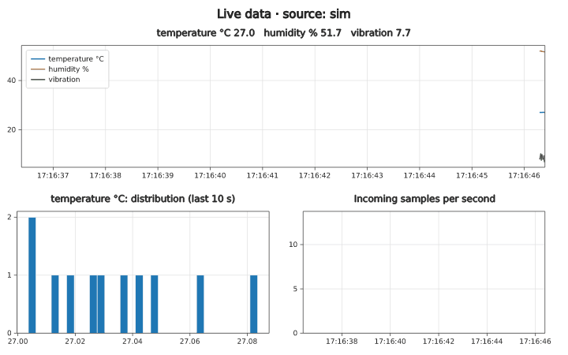 |
| [`plot-binance`](plot-binance) | Live Binance BTC/USDT dashboard: candles, volume, trades, order book, buy/sell pressure |  |
| [`plot-terminal`](plot-terminal) | Charts in the terminal (half blocks / braille) | [terminal.txt](plot-terminal/screenshots/terminal.txt) |
| [`plot-backends`](plot-backends) | CPU, multi-core and GPU rendering with timings |  |

## License

MIT, see [LICENSE](LICENSE).
