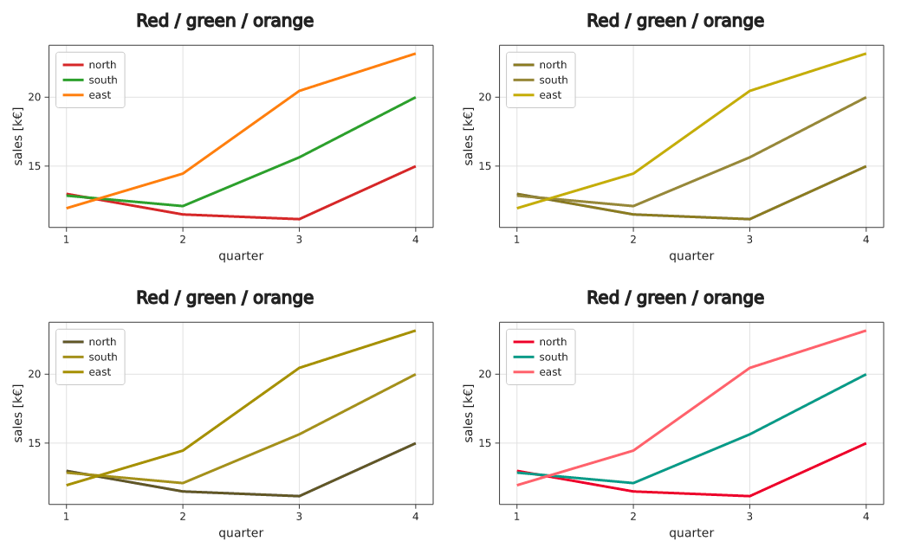
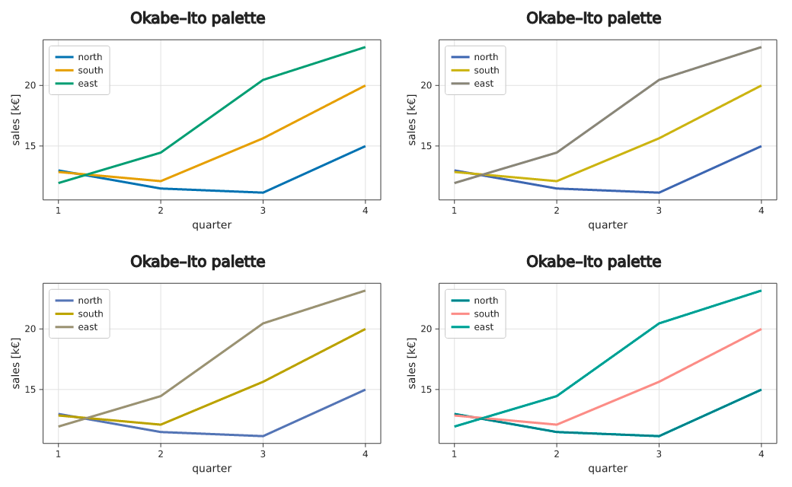

# Accessibility

Charts for everyone:

- SVG, PDF and HTML output carry an accessible name and a description that
  screen readers read: `fig.alt_text()` generates it from the plots, axes,
  ranges and series, or set your own with `fig.description(..)`.
- `fig.color_warnings()` lists series whose colors are hard to tell apart,
  normally or with protanopia, deuteranopia or tritanopia.
- `Pixels::simulate(Cvd::Deuteranopia)` shows a chart as people with a
  color vision deficiency see it.

Red, green and orange lines — normal, deuteranopia, protanopia, tritanopia:



The same chart with the colour-blind safe Okabe–Ito palette:



Output:

```text
Alt text: Red / green / orange. Line chart; quarter from 0.850 to 4.150; sales [k€] from 10.55 to 23.77. Series: north (11.148 to 14.988); south (12.097 to 19.997); east (11.94 to 23.17).

warning: "north" and "south" look alike with deuteranopia
warning: "south" and "east" look alike with protanopia

with Okabe–Ito: 0 warnings
```

Built with the [`dataviz::plot`](https://docs.rs/dataviz/latest/dataviz/plot/) API.

## Run

```sh
git clone https://github.com/dataviz-rs/dataviz-examples.git
cd dataviz-examples/plot-accessibility
cargo run --release
```

Writes `risky.png`, `risky.svg` and `safe.png`. See [`src/main.rs`](src/main.rs)
for the code.

## License

MIT
