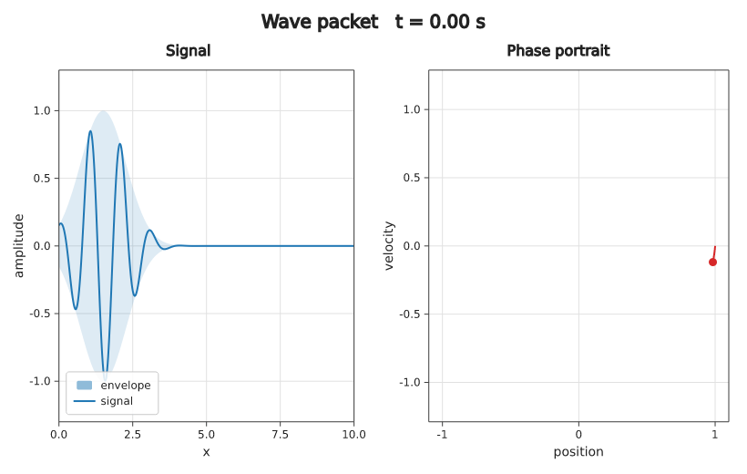

# Animations

A travelling wave packet and the phase portrait of a damped oscillator,
recorded with `Figure::record` as a GIF, a lossless animated PNG and a
lossless animated WebP (the format follows the extension).



Only the part of each frame that changed is stored. For 90 frames at
820×520:

| Format | Size | Time | Colors |
|---|---:|---:|---|
| GIF | 815 KB | 0.23 s | at most 256 per frame |
| APNG | 2169 KB | 0.14 s | full color, transparency |
| WebP | 1858 KB | 0.15 s | full color, transparency |
 The same call writes `.mp4` / `.webm` when
`ffmpeg` is installed. For data arriving over time, use `Recorder::push_at`
(see [`plot-streaming`](../plot-streaming)); in a window `V` records a GIF.

Built with the [`dataviz::plot`](https://docs.rs/dataviz/latest/dataviz/plot/) API.

## Run

```sh
git clone https://github.com/dataviz-rs/dataviz-examples.git
cd dataviz-examples/plot-animation
cargo run --release
```

Writes `animation.gif`, `animation.png` and `animation.webp` to the
current directory. See
[`src/main.rs`](src/main.rs) for the code.

## License

MIT
