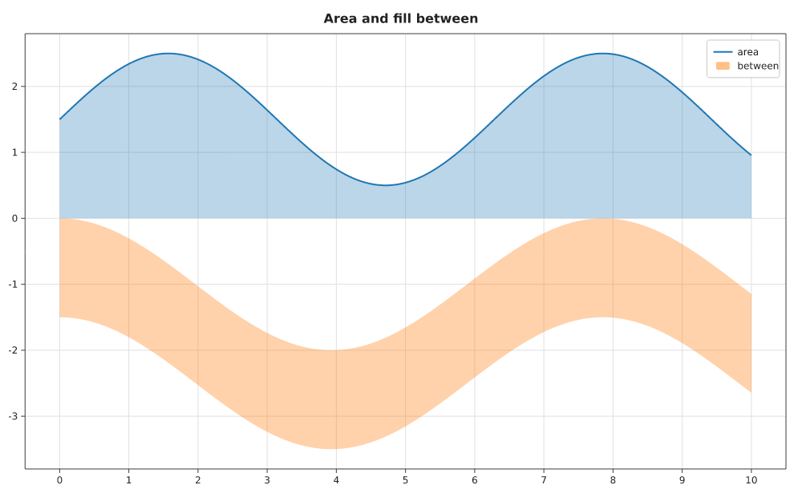

# Area and fill between

Filled area under a curve and the band between two curves.

Built with the [`dataviz::plot`](https://docs.rs/dataviz/latest/dataviz/plot/) API.



## Run

```sh
git clone https://github.com/dataviz-rs/dataviz-examples.git
cd dataviz-examples/plot-area-fill
cargo run --release
```

Writes `area_fill.png` and `area_fill.svg` to the current directory. See
[`src/main.rs`](src/main.rs) for the code.

## License

MIT
