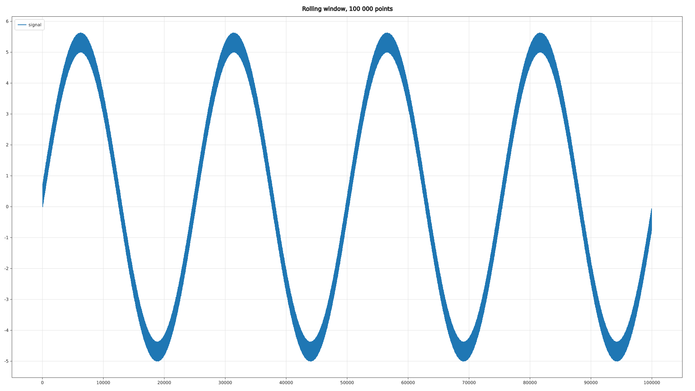

# Raster backends

The same real-time chart (1920×1080, rolling 100 000 points) drawn on one CPU
thread, on all cores and, with `--features gpu`, on the GPU (Vulkan, Metal,
DirectX 12 or OpenGL through wgpu). Prints the time and CPU time per frame.

Built with the [`dataviz::plot`](https://docs.rs/dataviz/latest/dataviz/plot/) API
(`Figure::backend`, `Figure::render_0rgb`).



## Run

```sh
git clone https://github.com/dataviz-rs/dataviz-examples.git
cd dataviz-examples/plot-backends
cargo run --release                  # CPU backends
cargo run --release --features gpu   # + GPU backend
```

Writes `backends.png` to the current directory and prints the timings of
100 frames (`cargo run --release -- 20` for another count), e.g.
([`screenshots/timings.txt`](screenshots/timings.txt)). See
[`src/main.rs`](src/main.rs) for the code.

## License

MIT
