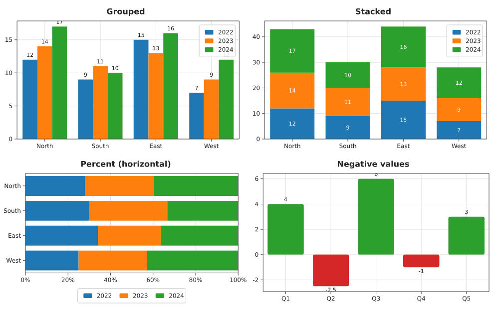

# Bar charts

Grouped, stacked, percent (horizontal) and negative-value bar charts with value labels.

Built with the [`dataviz::plot`](https://docs.rs/dataviz/latest/dataviz/plot/) API.



## Run

```sh
git clone https://github.com/dataviz-rs/dataviz-examples.git
cd dataviz-examples/plot-bars
cargo run --release
```

Writes `bars.png` and `bars.svg` to the current directory. See
[`src/main.rs`](src/main.rs) for the code.

## License

MIT
