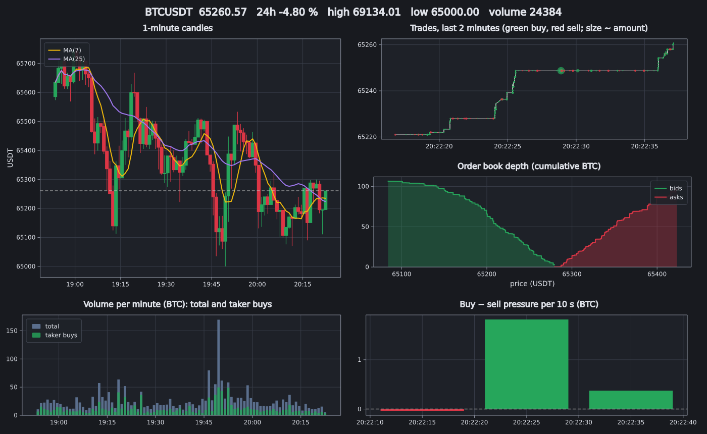

# Live Binance market dashboard

Live BTC/USDT (or any spot symbol) from Binance's public market-data API,
redrawn about once a second (`Figure::show_live`, dark theme):

- 1-minute candlesticks with MA(7) and MA(25) and the last price,
- volume per minute (total and taker buys),
- every trade of the last two minutes (buys green, sells red, marker size by amount),
- order-book depth (cumulative bids and asks, 500 levels),
- taker buy minus sell volume per 10 seconds,
- 24 h change, high, low and volume in the title.



A background thread polls `https://data-api.binance.vision/api/v3`
(`trades`, `depth`, `klines`, `ticker/24hr`) with the system's `curl`, so
there is no HTTP or JSON dependency and no API key; the window only redraws
when new data arrived. Times are shown in the local time zone.

## Run

```sh
git clone https://github.com/dataviz-rs/dataviz-examples.git
cd dataviz-examples/plot-binance
cargo run --release                 # BTCUSDT
cargo run --release -- ETHUSDT      # any spot symbol
cargo run --release -- BTCUSDT --png binance.png --seconds 10   # snapshot, no window
```

Needs `curl` and network access to `data-api.binance.vision`. Market data
only, for illustration; not financial advice.

## License

MIT
