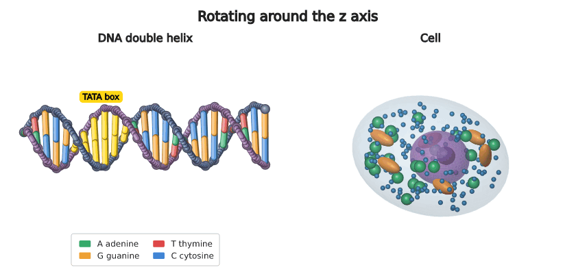
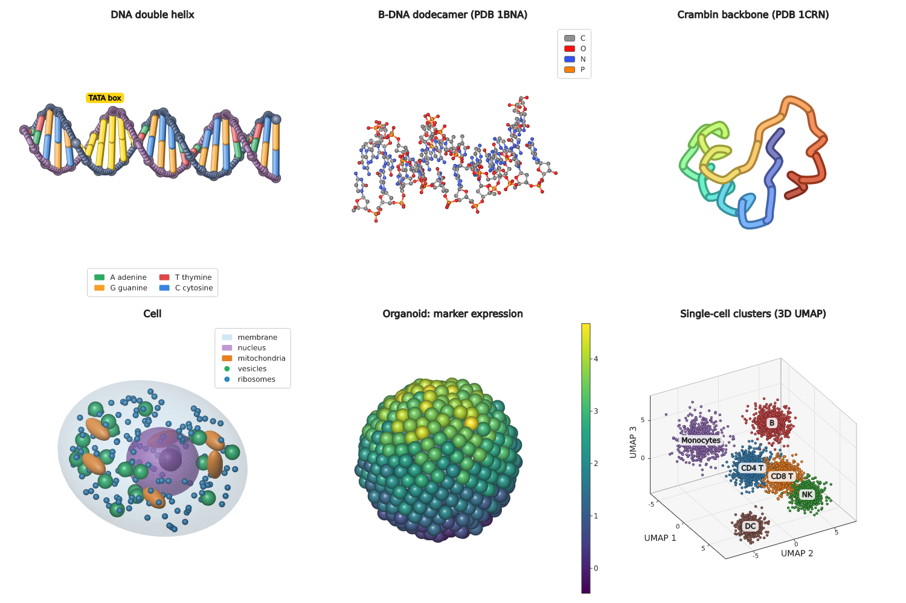
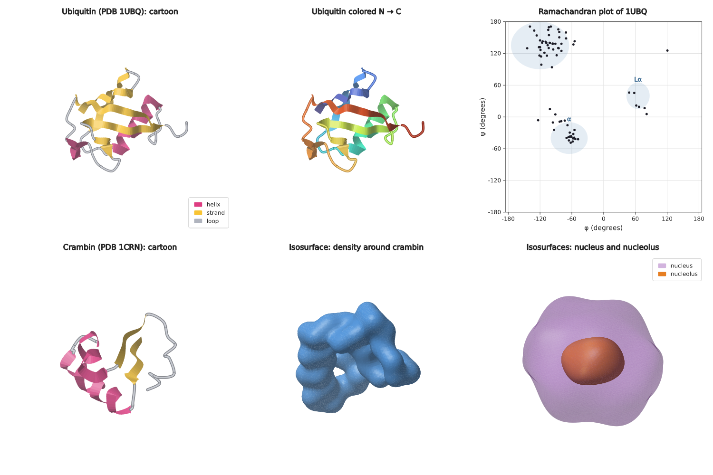

# 3D biology: DNA, molecules, cells

A DNA double helix with base pairs colored by base and a marked TATA box,
real structures from the Protein Data Bank (the B-DNA dodecamer 1BNA as
ball-and-stick with CPK colors, the protein crambin 1CRN as a backbone tube
colored from N- to C-terminus), a cell (translucent membrane, nucleus with
nucleolus, mitochondria, vesicles, ribosomes), an organoid of cells colored
by a marker gene, and single-cell clusters on a 3D UMAP.







Proteins: ubiquitin (PDB 1UBQ) and crambin (1CRN) as cartoons (helices as
ribbons, strands as arrows, from the PDB HELIX/SHEET records), ubiquitin
colored from N- to C-terminus, its Ramachandran plot from the backbone
dihedrals, and isosurfaces (marching tetrahedra) of a density around
crambin and of a nucleus with its nucleolus.

```rust
ax.molecule(Molecule::from_pdb(&pdb)).style(MolStyle::Cartoon);
let angles = molecule.phi_psi();               // (φ, ψ, residue)
ax.ramachandran(&phi, &psi);
ax.isosurface_fn(|x, y, z| density(x, y, z), bounds, 64, 0.55);
ax.isosurface(&volume, [nx, ny, nz], bounds, level);   // microscopy / CT stacks
```

```rust
ax.dna_helix("ATGCGTATAAAAGCC").highlight(5..11, "#ffd400", Some("TATA box"));
ax.molecule(Molecule::from_pdb(&pdb)).style(MolStyle::BallAndStick);
ax.molecule(Molecule::from_pdb(&pdb)).style(MolStyle::Backbone).coloring(MolColor::Rainbow);
ax.ellipsoid([0.0, 0.0, 0.0], [10.0, 8.0, 6.0]).opacity(0.16);   // membrane
ax.spheres3d(&x, &y, &z, [1.0]).values(&expression, Colormap::Viridis);
ax.embedding3d(&umap1, &umap2, &umap3, cell_types);
ax.rotate(Axis3::X, 30.0);
```

Molecules are read from PDB (`ATOM`/`HETATM`) or XYZ text; bonds are found
from covalent radii with a spatial grid (linear time). Styles: ball-and-stick,
sticks, space-filling and backbone; colors by element, chain or along the
chain. Structures open with their longest extent across the screen
(principal axes) and far parts fade into the background for depth.

## Turning the scenes

`cargo run --release -- --window` opens the figure in a window: drag to
turn, wheel to zoom, `X`/`Y`/`Z` to rotate by 15° around that axis
(Shift+key the other way), `R` to reset, hover an atom or base pair for its
name. In code: `ax.rotate(Axis3::Z, 15.0)`, `ax.roll(..)`,
`ax.camera(azimuth, elevation)`; `rotate.gif` is recorded that way.

Built with the [`dataviz::plot`](https://docs.rs/dataviz/latest/dataviz/plot/) API.

## Run

```sh
git clone https://github.com/dataviz-rs/dataviz-examples.git
cd dataviz-examples/plot-biology-3d
cargo run --release              # biology_3d.png, protein.png and rotate.gif
cargo run --release -- --window  # interactive
```

See [`src/main.rs`](src/main.rs) for the code.

## Data

`data/1BNA.pdb`, `data/1CRN.pdb` and `data/1UBQ.pdb` are from the
[RCSB Protein Data Bank](https://www.rcsb.org/) (public domain, CC0):
1BNA, Drew et al. 1981, *Structure of a B-DNA dodecamer*; 1CRN, Teeter
1984, *Crambin*; 1UBQ, Vijay-Kumar et al. 1987, *Structure of ubiquitin
refined at 1.8 Å resolution*.

## License

MIT
