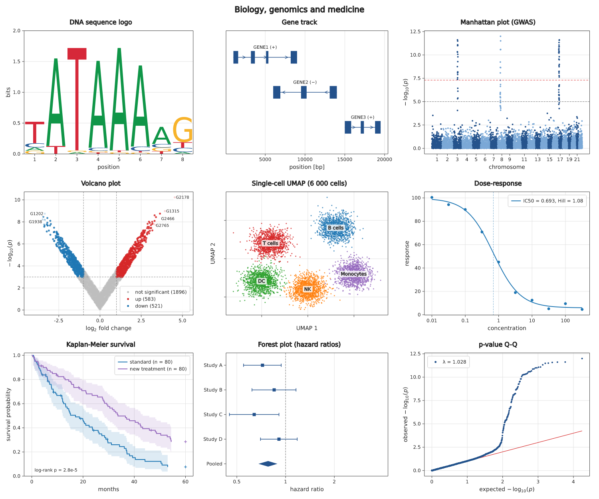
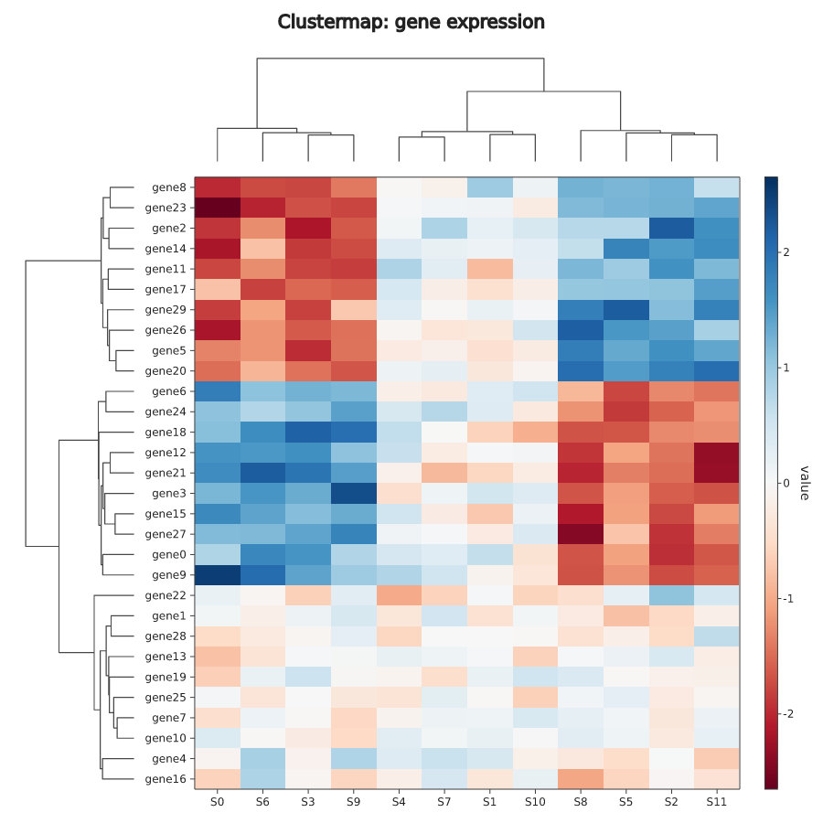

# Charts for biology, genomics and medicine

A DNA sequence logo (letters scaled to their information content), a gene
track (exons, introns, strand), a GWAS Manhattan plot with its p-value Q-Q
plot, a volcano plot naming the top genes, single-cell clusters on a UMAP,
a dose-response curve with a four-parameter logistic fit and IC50,
Kaplan-Meier survival with the log-rank test, a forest plot of hazard
ratios, and a clustermap of gene expression.





```rust
ax.sequence_logo(&aligned);
ax.gene_track(&genes);
ax.manhattan(chromosome, position, &p);
ax.volcano(names, &log2_fc, &p, 1.0, 1e-3, 6);
ax.embedding(&umap_x, &umap_y, cell_types);
ax.dose_response(&dose, &response);
ax.kaplan_meier([("standard", t1, e1), ("new treatment", t2, e2)]);
ax.forest_plot(studies, hr, low, high, 1.0).summary_last(true);
fig.clustermap(genes, samples, &expression);
```

Built with the [`dataviz::plot`](https://docs.rs/dataviz/latest/dataviz/plot/) API.

## Run

```sh
git clone https://github.com/dataviz-rs/dataviz-examples.git
cd dataviz-examples/plot-biology
cargo run --release
```

Writes `biology.png`, `biology.svg` and `clustermap.png`. See
[`src/main.rs`](src/main.rs) for the code.

## License

MIT
