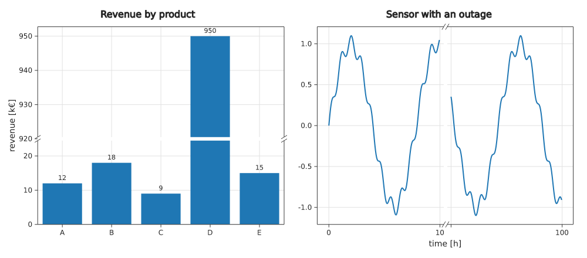

# Broken axes

`Axis::break_at(from, to)` leaves an empty range out of an axis: one very
large bar next to small ones stays readable, and a recording with a long
outage does not waste the plot on the gap. The break is marked with a gap
and `//` on the axis, ticks are placed per segment and lines do not jump
over it.



```rust
ax.y_axis().break_at(25.0, 920.0);
```

Built with the [`dataviz::plot`](https://docs.rs/dataviz/latest/dataviz/plot/) API.

## Run

```sh
git clone https://github.com/dataviz-rs/dataviz-examples.git
cd dataviz-examples/plot-broken-axis
cargo run --release
```

Writes `broken_axis.png` and `broken_axis.svg`. See [`src/main.rs`](src/main.rs)
for the code.

## License

MIT
