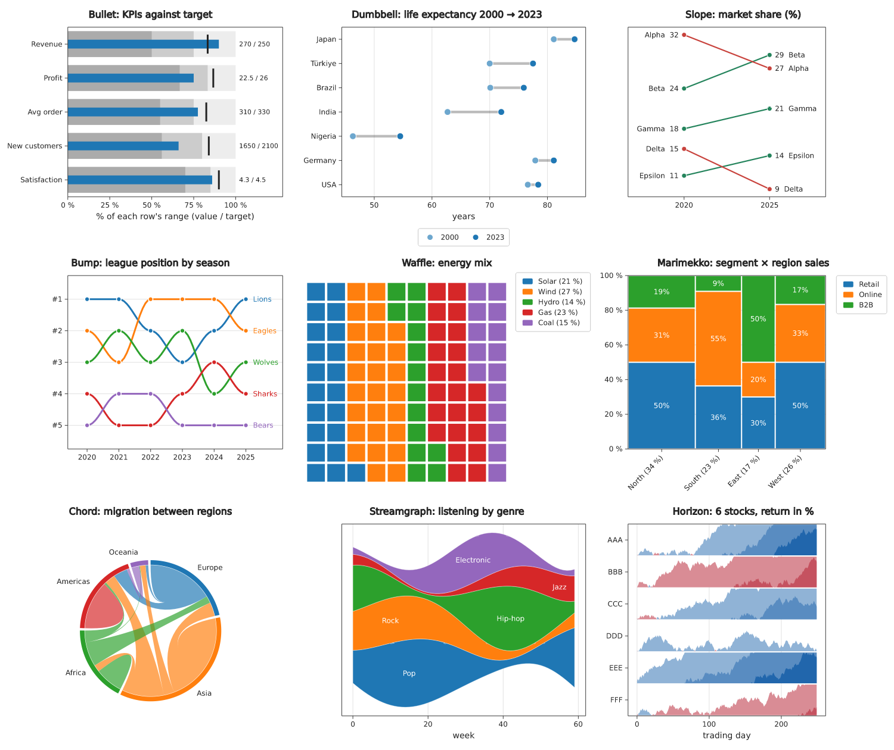

# Business and editorial charts

A bullet chart of KPIs against targets, a dumbbell chart, a slope chart, a
bump chart of league positions, a waffle chart, a marimekko (mosaic) chart,
a chord diagram of migration flows, a streamgraph and a horizon chart of six
stocks.



```rust
ax.bullet(kpis, values, targets, &ranges);
ax.dumbbell(countries, &y2000, &y2023).labels("2000", "2023");
ax.slope(brands, &share_2020, &share_2025, "2020", "2025");
ax.bump(teams, seasons, &ranks);
ax.waffle(sources, shares);
ax.marimekko(regions, segments, &sales);
ax.chord(regions, &flows);
ax.streamgraph(&weeks, &[("Pop", pop), ("Rock", rock)]);
ax.horizon(&days, &[("AAA", returns_a), ("BBB", returns_b)]);
```

Shapes of one color are merged into one path and curves are flattened, so
each chart is a handful of nodes for the rasterizer.

Built with the [`dataviz::plot`](https://docs.rs/dataviz/latest/dataviz/plot/) API.

## Run

```sh
git clone https://github.com/dataviz-rs/dataviz-examples.git
cd dataviz-examples/plot-business
cargo run --release
```

Writes `business.png` and `business.svg`. See [`src/main.rs`](src/main.rs)
for the code.

## License

MIT
