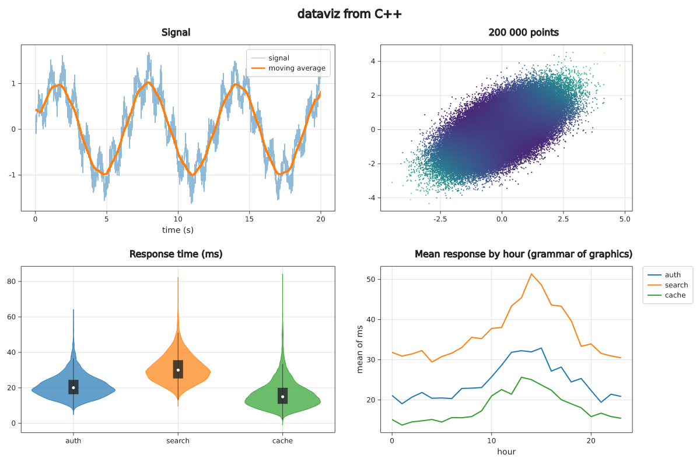

# dataviz from C and C++

The dataviz renderer as a C library with a header-only C++17 wrapper
(`dataviz.h`, `dataviz.hpp`). It runs on Linux, macOS and Windows, and
iOS and Android get static libraries. CMake downloads dataviz and builds
the library with cargo, so you need CMake 3.16+, a C/C++ compiler and
[Rust](https://rustup.rs).



[`dashboard.cpp`](dashboard.cpp) builds the dashboard above and saves it
as PNG and SVG in about 85 ms. It uses three ways in:

- **Direct calls:** `line`, `scatter`, `hist`, `heatmap`, `density`,
  `scatter3d`, `surface`, `candlestick`.
- **Any chart type through a JSON spec:** large arrays stay binary. A
  field `"@a"` takes the array named `a`, copied once and never turned
  into text. For 1 M points this takes 4 ms; the same data as JSON
  numbers takes 166 ms.
- **The grammar of graphics:** data, a mark and encodings.

```cpp
#include "dataviz.hpp"

dataviz::Figure fig(1200, 800);
auto ax = fig.axes(0, 0);
ax.line(t, signal, dataviz::Style().label("signal").width(1.0));
ax.title("Signal").xlabel("time (s)");
fig.axes(1, 0).plot(R"({"type": "violin", "groups": {"auth": "@a", "search": "@b"}})",
                    {{"a", auth_ms}, {"b", search_ms}});
fig.save("dashboard.png");      // .svg .pdf .html .jpg .webp
```

[`live.c`](live.c) is a live window in plain C: a sensor value arrives
every frame, the last 600 points are kept, and zoom, pan and hover work.

```c
static int update(dv_figure *fig, void *user) {
    state *s = user;
    dv_series_push(s->raw, s->t, read_sensor(), 600);
    return 1;   /* redraw */
}
dv_figure_show_live(fig, "sensor", 60, update, &s);
```

In your own UI (Qt, GTK, Dear ImGui, SDL, a game engine),
`dv_figure_render` returns RGBA pixels to upload as a texture.
`dv_figure_zoom`, `dv_figure_pan`, `dv_figure_click` and
`dv_figure_hover` handle the user's input.

## Run

```sh
git clone https://github.com/dataviz-rs/dataviz-examples.git
cd dataviz-examples/plot-c-cpp
cmake -S . -B build -DCMAKE_BUILD_TYPE=Release
cmake --build build --config Release
cd screenshots && ../build/dashboard     # writes dashboard.png and dashboard.svg
../build/live                            # live window
```

On Windows the programs are in `build\Release\`, and CMake copies
`dataviz_c.dll` next to them. Prebuilt libraries for every platform are
attached to the `c-v*` releases of
[dataviz](https://github.com/dataviz-rs/dataviz/releases). The API is
described in [capi/README.md](https://github.com/dataviz-rs/dataviz/tree/main/capi).

## License

MIT
