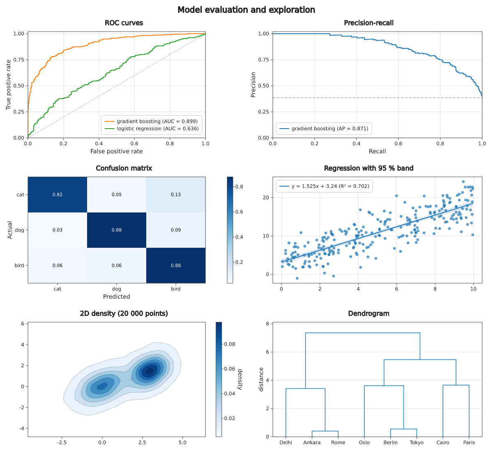
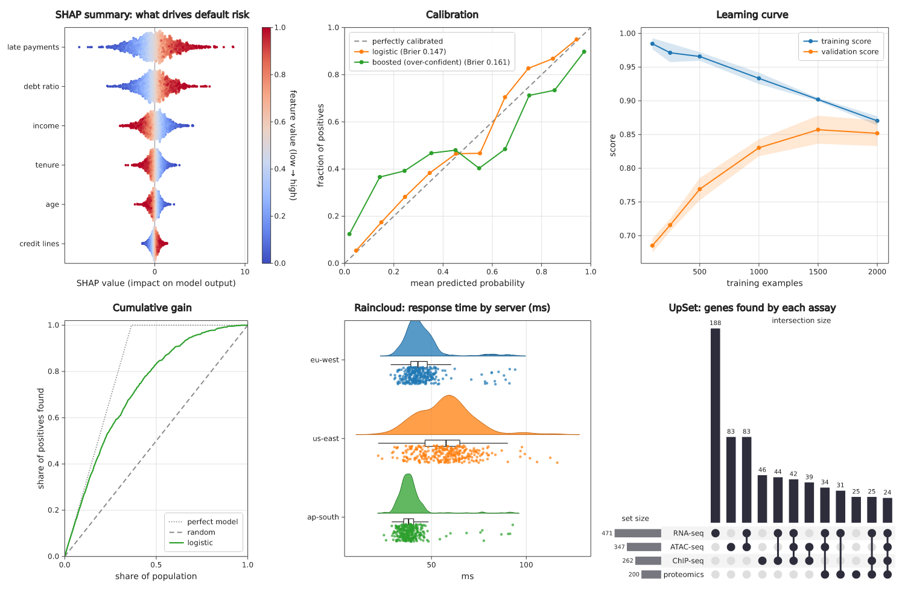

# Charts for data scientists

ROC curves with the AUC in the legend, a precision-recall curve, a
normalized confusion matrix, a regression line with its 95 % confidence
band and R², 2D density contours of 20 000 points and a dendrogram of
hierarchical clustering.



```rust
ax.roc_curve("gradient boosting", &labels, &scores);
ax.pr_curve("gradient boosting", &labels, &scores);
ax.confusion_matrix(["cat", "dog", "bird"], &actual, &predicted, true);
ax.regplot(&x, &y);
ax.density_contour(&a, &b);
ax.dendrogram(names, &features);
```

## Model evaluation and explanation

A SHAP summary (beeswarm) of a credit-default model, calibration curves of
a well calibrated and an over-confident model (Brier scores in the legend),
a learning curve with ±1σ bands, a cumulative gain chart, a raincloud plot
(half violin, box and points) and an UpSet plot of genes found by four
assays.



```rust
ax.shap_summary(&feature_names, &shap_values, &feature_values, 10);
ax.calibration_curve("logistic", &labels, &probabilities, 10);
ax.learning_curve(&sizes, &train_scores, &validation_scores);
ax.gain_curve("logistic", &labels, &scores);      // also lift_curve
ax.raincloud([("eu-west", a), ("us-east", b)]);
ax.upset(&[("RNA-seq", genes_a), ("ATAC-seq", genes_b)], 12);
```

Built with the [`dataviz::plot`](https://docs.rs/dataviz/latest/dataviz/plot/) API.

## Run

```sh
git clone https://github.com/dataviz-rs/dataviz-examples.git
cd dataviz-examples/plot-data-science
cargo run --release
```

See [`src/main.rs`](src/main.rs) for the code.

## License

MIT
