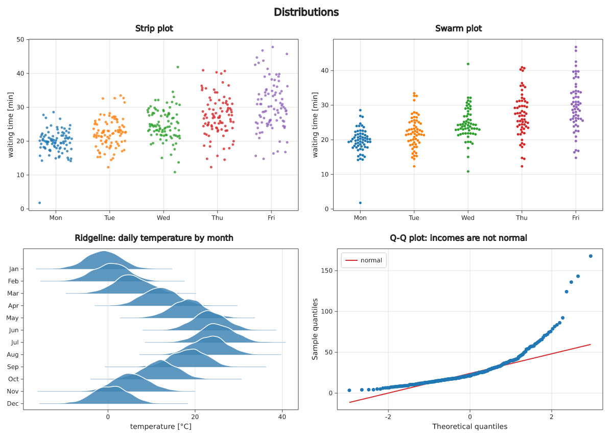

# Distributions

Strip plot (jittered points), swarm plot (points side by side without
overlap), a ridgeline of monthly temperatures (densities on overlapping
rows) and a Q-Q plot that shows incomes are not normally distributed.



```rust
ax.strip([("Mon", &mon), ("Tue", &tue)]);
ax.swarm([("Mon", &mon), ("Tue", &tue)]);
ax.ridgeline(months);   // (name, values) per row
ax.qq(&incomes);        // against the normal distribution
```

Built with the [`dataviz::plot`](https://docs.rs/dataviz/latest/dataviz/plot/) API.

## Run

```sh
git clone https://github.com/dataviz-rs/dataviz-examples.git
cd dataviz-examples/plot-distributions
cargo run --release
```

Writes `distributions.png` and `distributions.svg`. See
[`src/main.rs`](src/main.rs) for the code.

## License

MIT
