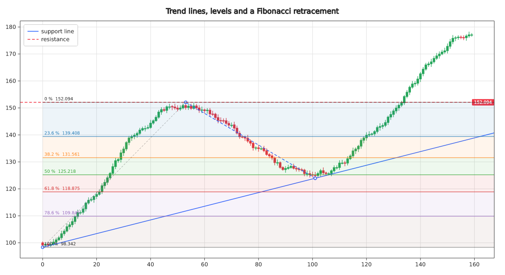

# Drawing tools

The drawing tools of trading platforms, in code or with the mouse:

- trend lines and rays (continued to the edge of the plot);
- price levels, with the value in a tag on the price axis;
- Fibonacci retracements: the 0, 23.6, 38.2, 50, 61.8, 78.6 and 100 %
  levels, with their prices, over shaded bands.

Drawings keep their data positions when you zoom or pan, and they are
saved with the chart (PNG, SVG, PDF, HTML).



```rust
ax.candlestick(x, open, high, low, close);
ax.ray((5.0, 98.3), (101.0, 123.9)).label("support line");
ax.price_level(152.1).label("resistance");
ax.fib_retracement((0.0, 98.3), (53.0, 152.1));
```

In a window (`cargo run --release -- --show`), you draw with the mouse:

| Key | Then |
|---|---|
| `T` | drag from one point to another: trend line |
| `L` | click at a price: price level |
| `F` | drag from the start of a move to its end: Fibonacci retracement |
| Backspace | takes back the last drawing |

A dashed preview follows the mouse while you drag. The same drawings are
available in the JSON spec (`"drawings": [{"type": "fib", "from": [x, y],
"to": [x, y]}, …]`) and in Python (`ax.trendline`, `ax.price_level`,
`ax.fib_retracement`).

## Run

```sh
git clone https://github.com/dataviz-rs/dataviz-examples.git
cd dataviz-examples/plot-drawing-tools
cargo run --release            # writes drawing_tools.png
cargo run --release -- --show  # draw in a window
```

See [`src/main.rs`](src/main.rs) for the code.

## License

MIT
