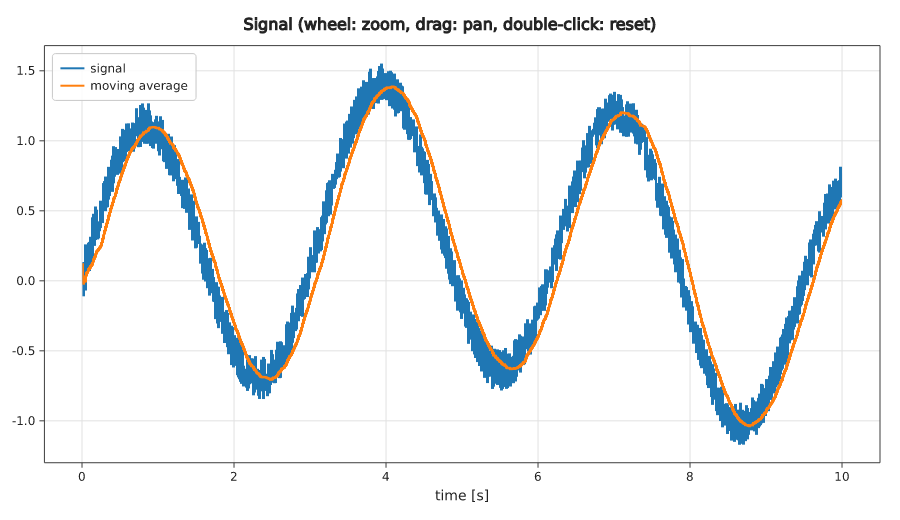

# dataviz inside an egui app

A live chart in an [egui](https://github.com/emilk/egui) application: each
frame the figure is rendered into a texture at the panel's size
(`Figure::render_into`, sharp on HiDPI screens) and the mouse is passed on
with dataviz's window-free interaction API — wheel to zoom (`zoom_at`),
drag to pan (`pan_by`), hover readouts (`hover`), legend clicks (`click`),
double-click to reset (`reset_view`). The side panel changes the data
speed, noise and theme while it streams.



The same approach works with any toolkit that can show an RGBA image
(iced, Slint, GTK, Qt, …).

## Run

```sh
git clone https://github.com/dataviz-rs/dataviz-examples.git
cd dataviz-examples/plot-egui
cargo run --release
```

`cargo run --release -- --screenshot egui.png` renders the chart once
without opening a window. See [`src/main.rs`](src/main.rs) for the code.

## License

MIT
