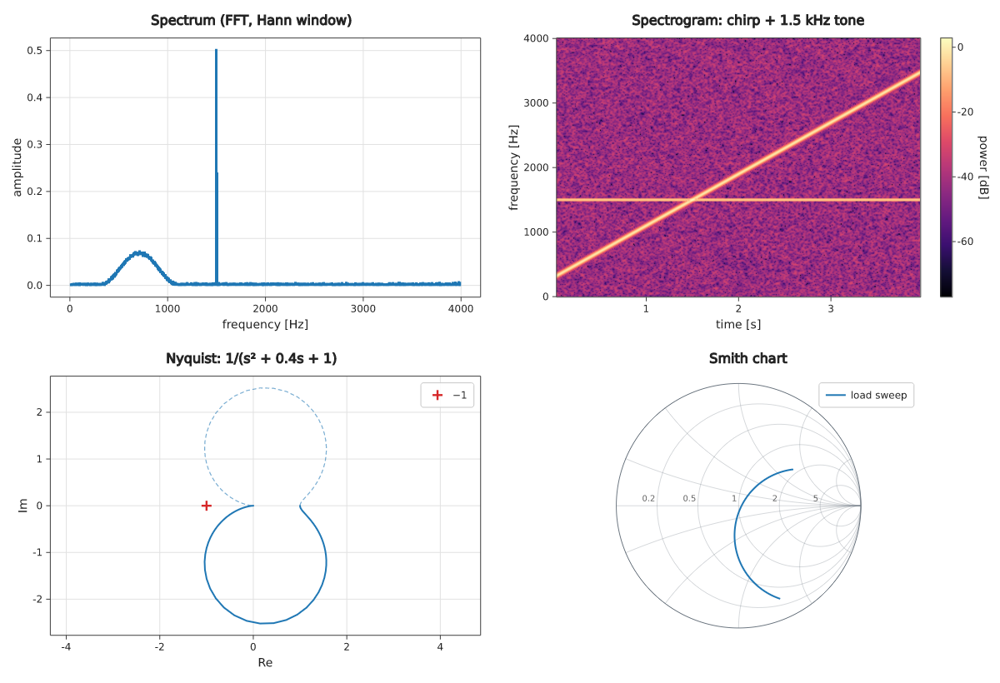
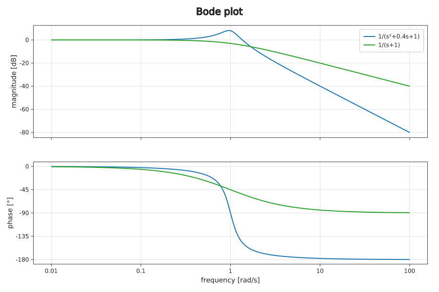
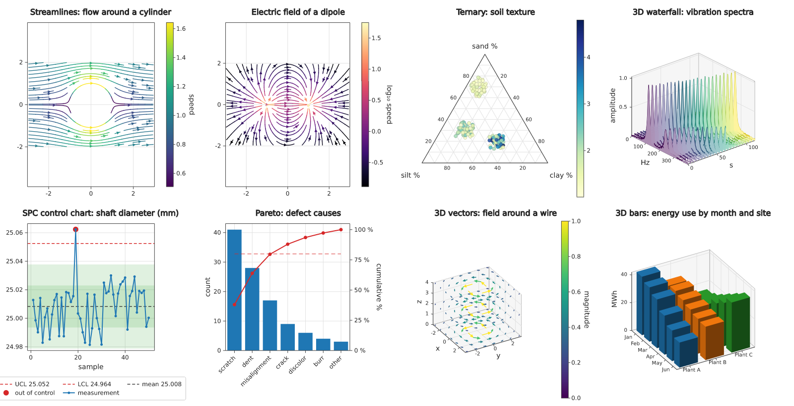

# Charts for engineers

An FFT amplitude spectrum, the spectrogram of a chirp with a steady tone,
the Nyquist plot of a second-order system, impedances on a Smith chart,
and a Bode plot (magnitude and unwrapped phase) of two transfer functions.







Streamlines of a flow around a cylinder and of a dipole field (colored by
speed, log scale when it spans decades), a ternary diagram of soil
texture, a 3D waterfall of vibration spectra, an SPC control chart (±1/2/3σ
zones, Western Electric rules 1 and 2), a Pareto chart, 3D vectors of the
field around a wire and 3D bars.

```rust
ax.streamplot(|x, y| (u(x, y), v(x, y)), (-3.0, 3.0), (-2.0, 2.0), 28);
ax.ternary(&sand, &silt, &clay).names("sand %", "silt %", "clay %");
ax.waterfall3d(&freq, &time, spectra);
ax.control_chart(&diameters);
ax.pareto(causes, counts);
ax.quiver3d(points, vectors);
ax.bar3d(months, sites, energy);
```

```rust
ax.spectrum(&signal, fs);
ax.spectrogram(&signal, fs, 512, 64);
let w = logspace(0.01, 100.0, 400);
let h = freq_response(&[1.0], &[1.0, 0.4, 1.0], &w);   // 1 / (s² + 0.4s + 1)
ax.nyquist(&h);
ax.smith(&impedances);
fig.bode("1/(s²+0.4s+1)", &w, &h);
```

Built with the [`dataviz::plot`](https://docs.rs/dataviz/latest/dataviz/plot/) API.

## Run

```sh
git clone https://github.com/dataviz-rs/dataviz-examples.git
cd dataviz-examples/plot-engineering
cargo run --release
```

See [`src/main.rs`](src/main.rs) for the code.

## License

MIT
