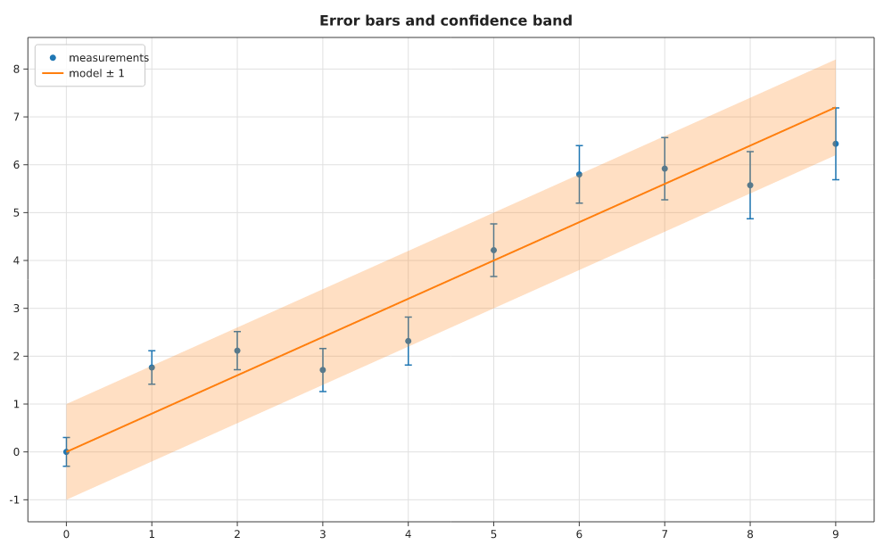

# Error bars and confidence bands

Measurements with error bars over a model line with a ±1 band.

Built with the [`dataviz::plot`](https://docs.rs/dataviz/latest/dataviz/plot/) API.



## Run

```sh
git clone https://github.com/dataviz-rs/dataviz-examples.git
cd dataviz-examples/plot-errorbars-band
cargo run --release
```

Writes `errorbars_band.png` and `errorbars_band.svg` to the current directory. See
[`src/main.rs`](src/main.rs) for the code.

## License

MIT
