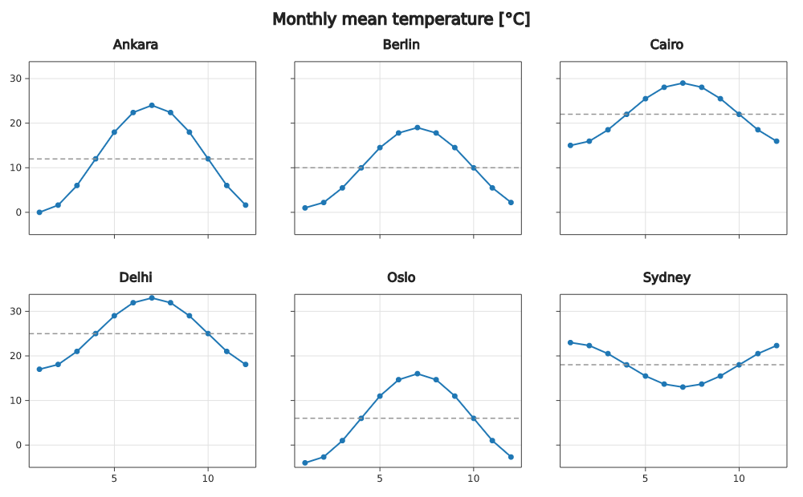
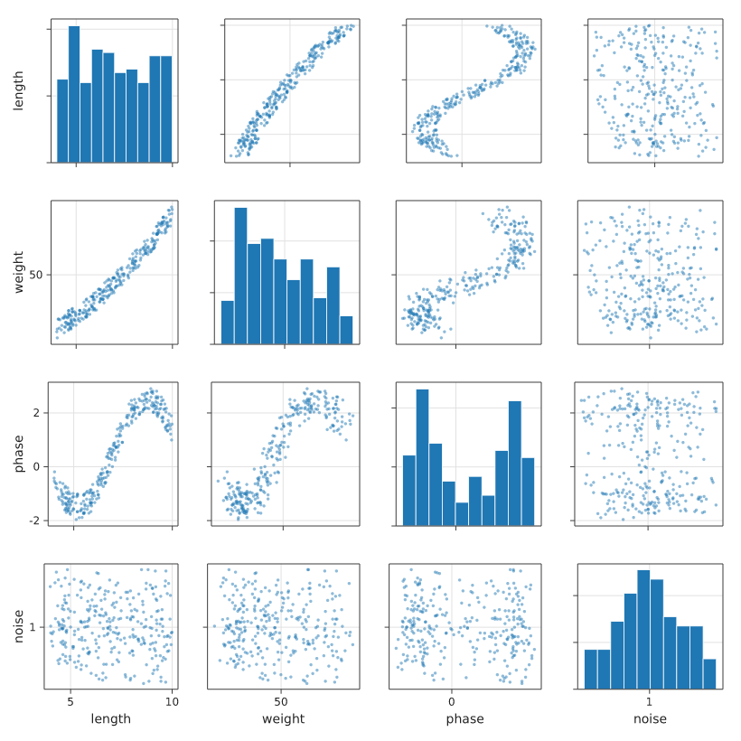

# Facets and pair plots

`Figure::facet_wrap` draws one plot per group in a grid with shared ranges
(tick labels on the outer plots only, all plots the same size);
`Figure::pair_plot` draws the scatter matrix of several variables with
histograms on the diagonal.





```rust
fig.facet_wrap(cities, 3, |ax, data| { ax.line(&months, data); });
fig.pair_plot([("length", &length), ("weight", &weight), ("phase", &phase)]);
```

Built with the [`dataviz::plot`](https://docs.rs/dataviz/latest/dataviz/plot/) API.

## Run

```sh
git clone https://github.com/dataviz-rs/dataviz-examples.git
cd dataviz-examples/plot-facets
cargo run --release
```

Writes `facets.png` and `pair_plot.png`. See [`src/main.rs`](src/main.rs)
for the code.

## License

MIT
