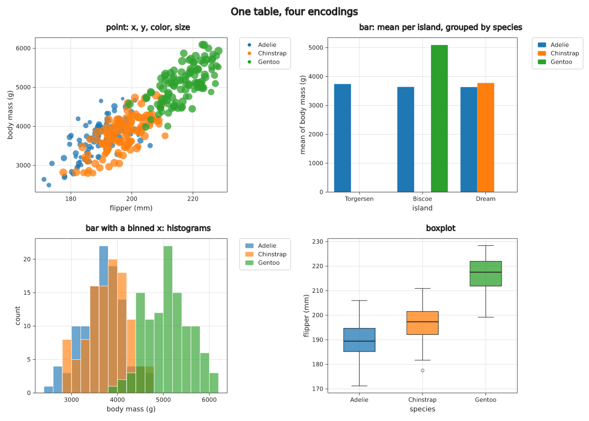
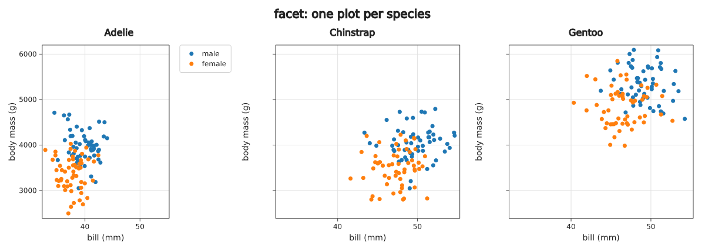

# Grammar of graphics

A chart described by **data, a mark and encodings**, the way Vega-Lite,
ggplot2 and Altair describe charts. From the encodings dataviz derives:

- color groups with a legend;
- aggregation (`count`, `sum`, `mean`, `median`, `min`, `max`);
- histograms, when x is binned;
- stacked, grouped or percent bars;
- heatmaps (`rect`) and box plots;
- small multiples (`facet`), with the same colors in every plot and a
  single legend.





```rust
use dataviz::plot::grammar::{Aggregate, Chart, Data, Field, Mark};

let data = Data::new()
    .text("species", species)
    .text("island", island)
    .num("body mass (g)", mass);
Chart::new(data, Mark::Bar)
    .x("island")
    .y(Field::new("body mass (g)").aggregate(Aggregate::Mean))
    .color("species")
    .stack(BarMode::Grouped)
    .draw(&mut fig)?;
```

The same chart as a JSON spec works from Python, JavaScript, C/C++ and the
MCP server:

```json
{"data": {"island": [...], "species": [...], "body mass (g)": [...]},
 "mark": "bar",
 "encoding": {"x": "island", "y": {"field": "body mass (g)", "aggregate": "mean"}, "color": "species"},
 "stack": "grouped"}
```

In Python, with pandas or Polars DataFrames and Altair shorthand:

```python
dv.plot(df, "bar", x="island", y="mean(body mass (g))", color="species", stack="grouped")
```

**Speed:** 1 000 000 rows in 3 color groups build in about 30 ms; with the
PNG saved, about 120 ms.

## Run

```sh
git clone https://github.com/dataviz-rs/dataviz-examples.git
cd dataviz-examples/plot-grammar
cargo run --release
```

Writes `grammar.png`, `grammar_facets.png` and `grammar_million.png`. See
[`src/main.rs`](src/main.rs) for the code.

## License

MIT
