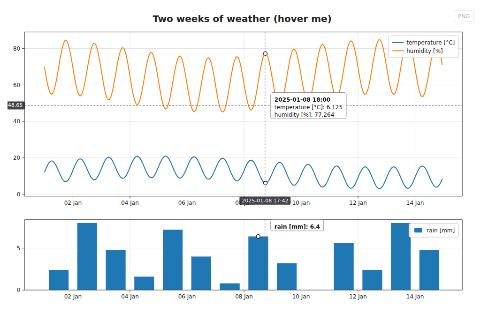

# Interactive HTML

`fig.save("weather.html")` writes one self-contained file: the chart as
SVG with a small script, no server, no internet access and no external
scripts needed. In the browser:

- a crosshair with the cursor's x and y values on the axes,
- a tooltip with every series' value at the cursor's x (and a linked
  cursor in plots sharing the x range),
- clicking a legend row hides or shows its series,
- a button saves the chart as PNG.



Built with the [`dataviz::plot`](https://docs.rs/dataviz/latest/dataviz/plot/) API.

## Run

```sh
git clone https://github.com/dataviz-rs/dataviz-examples.git
cd dataviz-examples/plot-html
cargo run --release
```

Writes `weather.html` (open it in a browser) and `weather.png`. See
[`src/main.rs`](src/main.rs) for the code.

## License

MIT
