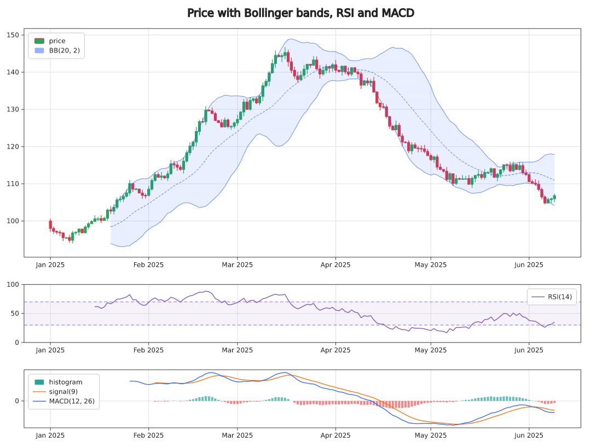
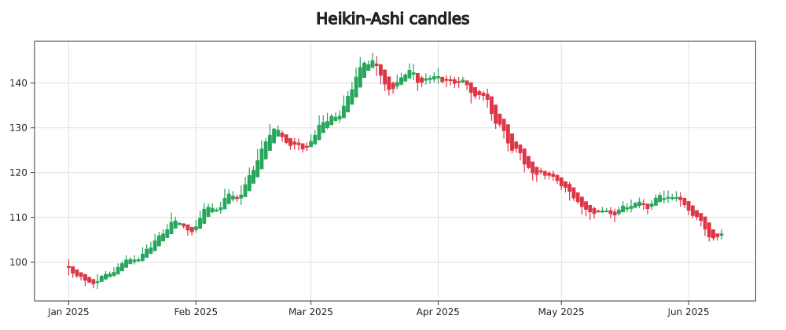

# Technical indicators

Candlesticks with Bollinger bands, the RSI with its 30/70 levels and the
MACD with its histogram, in panels that share the time axis and line up (in
a window they also share a crosshair and zoom together), plus Heikin-Ashi
candles.





```rust
ax.candlestick(&t, &open, &high, &low, &close);
ax.bollinger(&t, &close, 20, 2.0);
rsi_axes.rsi(&t, &close, 14);
macd_axes.macd(&t, &close, 12, 26, 9);
```

The indicator values are available as functions too:
`dataviz::plot::stats::{sma, ema, bollinger, rsi, macd, heikin_ashi}`.

Built with the [`dataviz::plot`](https://docs.rs/dataviz/latest/dataviz/plot/) API.

## Run

```sh
git clone https://github.com/dataviz-rs/dataviz-examples.git
cd dataviz-examples/plot-indicators
cargo run --release
```

Writes `indicators.png` and `heikin_ashi.png`. See [`src/main.rs`](src/main.rs)
for the code.

## License

MIT
