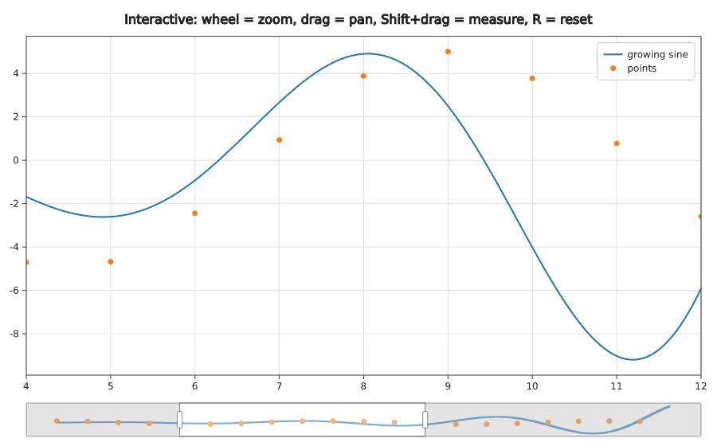
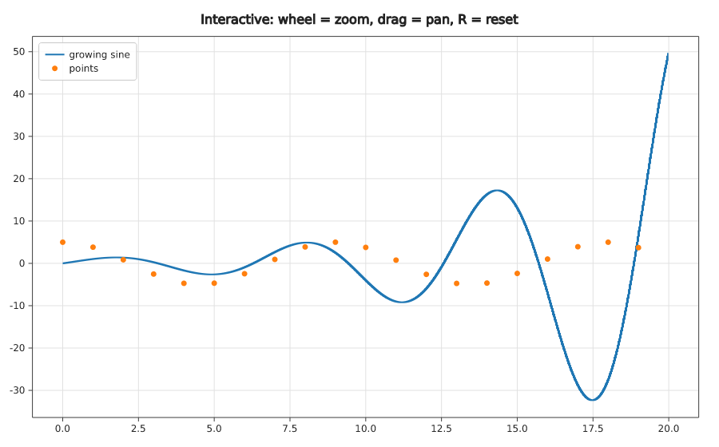

# Interactive window and live data

`Figure::show` opens a window: mouse wheel zooms around the cursor, left-drag pans, right-drag zooms to a box, the range slider below the plot is dragged to pan and at its edges to zoom, Shift+drag measures (Δx, Δy, change in %), Ctrl+drag selects a box (`Figure::selection()`), clicking a legend row hides or shows its series, `R` resets, `C` toggles the crosshair (cursor values on the axes and the series values at that x), `H` toggles hover tooltips, `S` saves a PNG, Shift+S an SVG, Ctrl+C copies to the clipboard, `V` records a GIF, `Esc` closes. Plots showing the same x range get a linked cursor and are zoomed and panned together. `Figure::show_live` then streams data into a rolling window.





The animation was recorded with `cargo run --release -- --demo`: wheel zoom and drag through the same calls a window or GUI makes (`zoom_at`, `pan_by`, `reset_view`), the range slider following the view.

## Run

```sh
git clone https://github.com/dataviz-rs/dataviz-examples.git
cd dataviz-examples/plot-interactive
cargo run --release
```

## License

MIT
