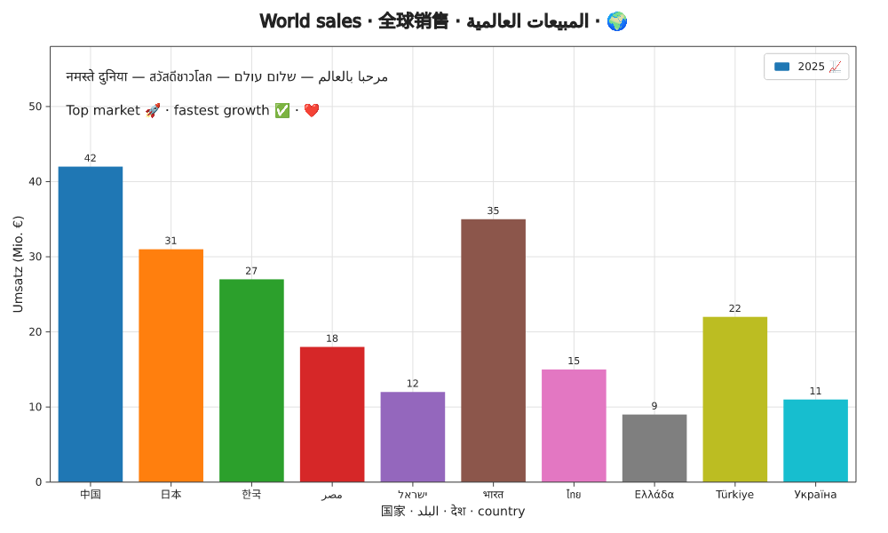

# Text in any language

Labels in Chinese, Japanese, Korean, Arabic, Hebrew, Hindi, Thai, Greek,
Turkish and Ukrainian, plus color emoji. Characters the theme font lacks
come from system fonts (scanned once, the first time they are needed),
Arabic and Hebrew are laid out right to left and shaped, and emoji are
drawn from a color emoji font. Latin text keeps a fast path.



The fonts come from the system: on Linux, for example, `fonts-noto-cjk`,
`fonts-noto-core` and `fonts-noto-color-emoji`. In SVG output the text is
written as text, so the viewer picks its own fonts.

Built with the [`dataviz::plot`](https://docs.rs/dataviz/latest/dataviz/plot/) API.

## Run

```sh
git clone https://github.com/dataviz-rs/dataviz-examples.git
cd dataviz-examples/plot-international
cargo run --release
```

Writes `international.png` and `international.svg` to the current directory.
See [`src/main.rs`](src/main.rs) for the code.

## License

MIT
