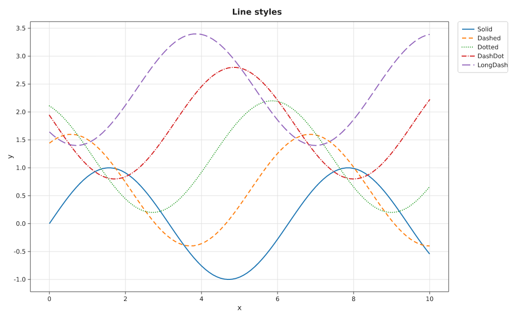

# Line styles

Solid, dashed, dotted, dash-dot and long-dash lines with an outside legend.

Built with the [`dataviz::plot`](https://docs.rs/dataviz/latest/dataviz/plot/) API.



## Run

```sh
git clone https://github.com/dataviz-rs/dataviz-examples.git
cd dataviz-examples/plot-line
cargo run --release
```

Writes `line.png` and `line.svg` to the current directory. See
[`src/main.rs`](src/main.rs) for the code.

## License

MIT
