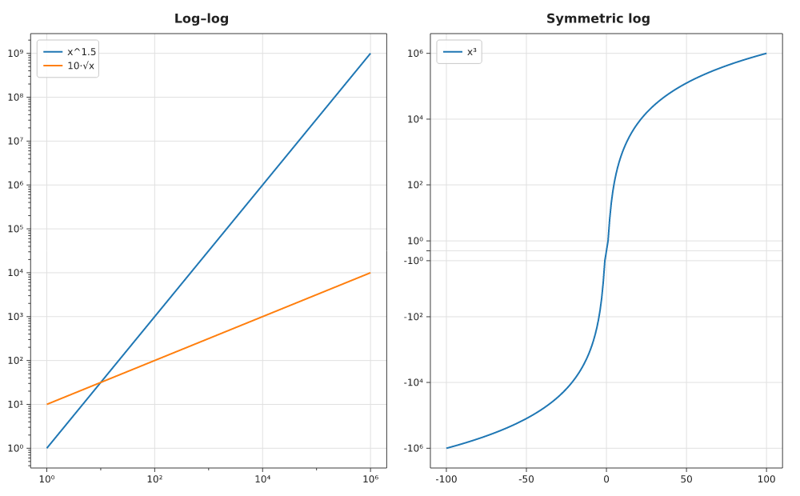

# Logarithmic scales

Log-log axes with minor ticks and a symmetric-log axis.

Built with the [`dataviz::plot`](https://docs.rs/dataviz/latest/dataviz/plot/) API.



## Run

```sh
git clone https://github.com/dataviz-rs/dataviz-examples.git
cd dataviz-examples/plot-log-scales
cargo run --release
```

Writes `log_scales.png` and `log_scales.svg` to the current directory. See
[`src/main.rs`](src/main.rs) for the code.

## License

MIT
