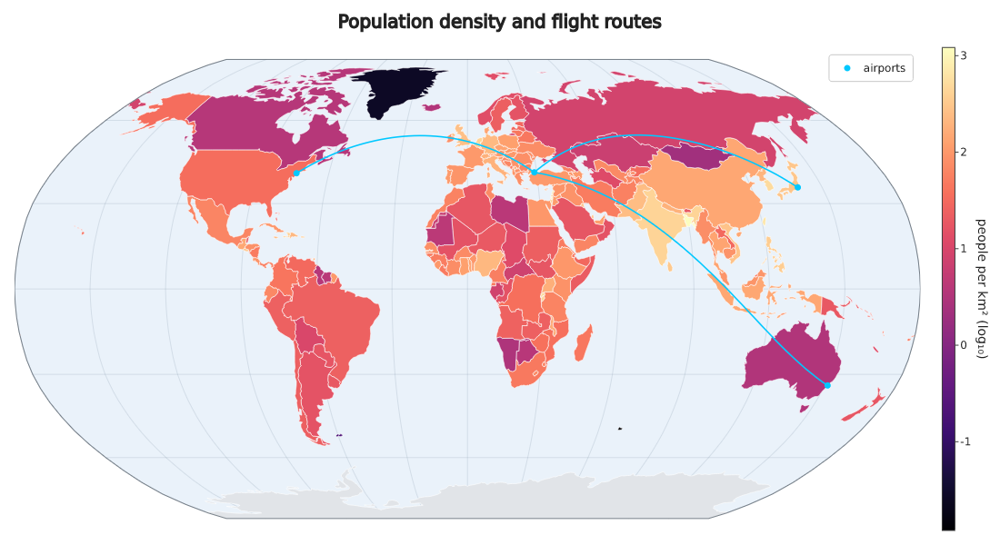

# Maps

A world choropleth of population density (log colors, colorbar, graticule)
with flight routes along great circles, and the world in the Robinson,
Natural Earth, equirectangular and Mercator projections. The country
outlines, ISO codes, population and GDP come with dataviz (Natural Earth
1:110m, public domain); hovering a country in a window shows its name and
value.




```rust
ax.map(Projection::Robinson);
ax.choropleth([("DEU", 83.2), ("TUR", 85.3), ("JP", 124.5), ("Brazil", 203.1)])
    .colorbar("population [M]");
ax.geo_line([28.98, -74.0], [41.01, 40.7]);       // great circle
ax.geo_scatter([28.98, -74.0], [41.01, 40.7]);
```

Regions or provinces from a GeoJSON file:
`ax.geo_shapes(&geo::read_geojson(&text)?, values, "name")`.

Built with the [`dataviz::plot`](https://docs.rs/dataviz/latest/dataviz/plot/) API.

## Run

```sh
git clone https://github.com/dataviz-rs/dataviz-examples.git
cd dataviz-examples/plot-maps
cargo run --release
```

Writes `maps.png`, `maps.svg` and `projections.png`. See
[`src/main.rs`](src/main.rs) for the code.

## License

MIT
