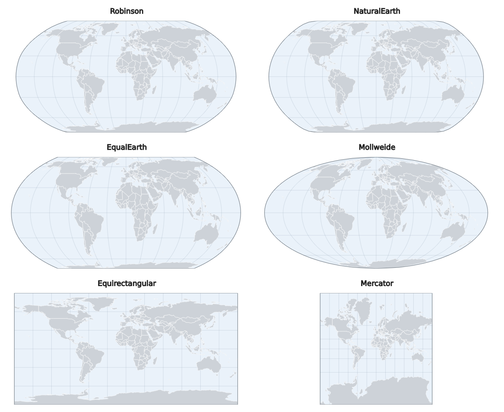
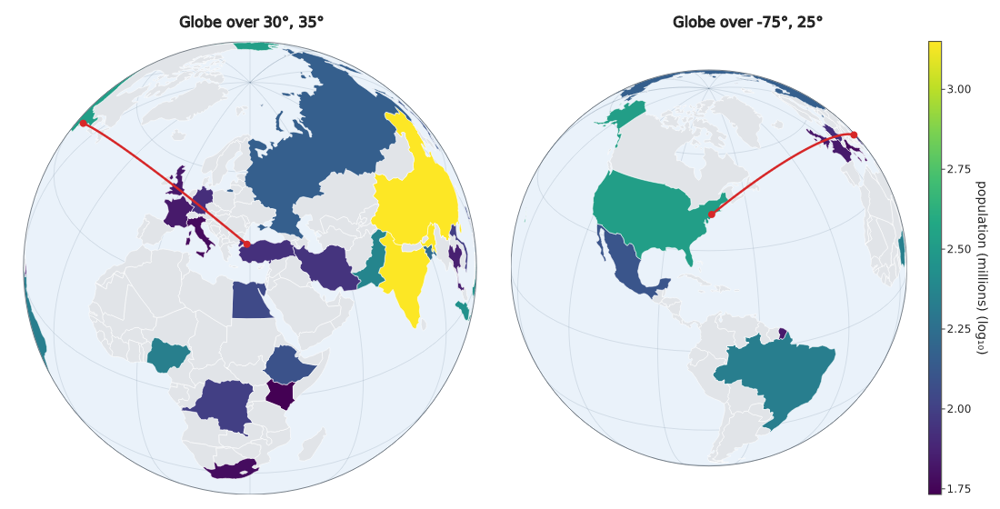
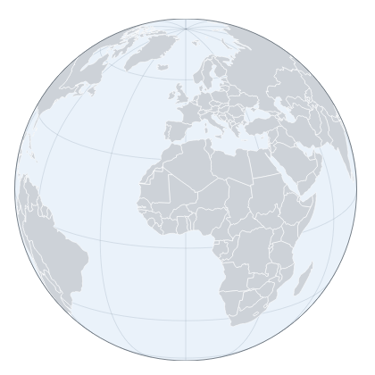
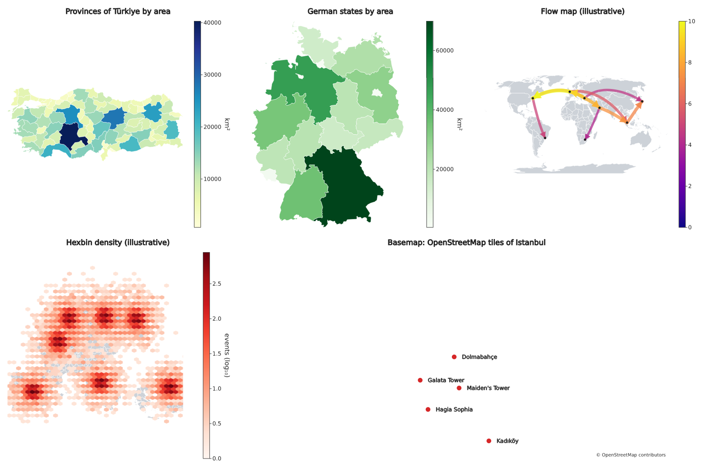

# Maps

A world choropleth of population density (log colors, colorbar, graticule)
with flight routes along great circles, and the world in the Robinson,
Natural Earth, equal-area Equal Earth and Mollweide, equirectangular and
Mercator projections. The country
outlines, ISO codes, population and GDP come with dataviz (Natural Earth
1:110m, public domain); hovering a country in a window shows its name and
value.




## Globe

`ax.globe(lon, lat)` shows the Earth from space (orthographic projection):
the far side is cut away along the rim, maps, routes and points follow.
`ax.globe_center(lon, lat)` turns it, so a spinning globe is a `record`
loop.




```rust
ax.globe(30.0, 35.0);
ax.choropleth(population).log(true).graticule(30.0);
ax.geo_line([28.98, -73.94], [41.01, 40.67]);           // great circle
fig.record("globe_spin.gif", 20.0, 60, |f, k| {
    f.axes().globe_center(k as f64 * 6.0, 20.0);
})?;
```



States and provinces of any country (feature `regions`: Natural Earth
1:10m admin-1, colored here by their area computed from the outlines), a
flow map along great circles, a hexbin density map and OpenStreetMap tiles
as a basemap (`cargo run --release -- --fetch-tiles` downloads the few
tiles once into `tiles/`, following the OSM tile usage policy).

```rust
ax.region_map("TUR", [("TR-34", 15.7), ("TR-06", 5.8)]);   // ISO 3166-2 codes or names
ax.geo_flows(&[(28.8, 41.0, -73.8, 40.6, 9.0)], &["IST–JFK"]);
ax.geo_hexbin(&lon, &lat).gridsize(45);
ax.basemap((28.9, 29.1), (40.98, 41.1), 12, tile_dir("tiles"), "© OpenStreetMap contributors");
```

```rust
ax.map(Projection::Robinson);
ax.choropleth([("DEU", 83.2), ("TUR", 85.3), ("JP", 124.5), ("Brazil", 203.1)])
    .colorbar("population [M]");
ax.geo_line([28.98, -74.0], [41.01, 40.7]);       // great circle
ax.geo_scatter([28.98, -74.0], [41.01, 40.7]);
```

Regions or provinces from a GeoJSON file:
`ax.geo_shapes(&geo::read_geojson(&text)?, values, "name")`.

Built with the [`dataviz::plot`](https://docs.rs/dataviz/latest/dataviz/plot/) API.

## Run

```sh
git clone https://github.com/dataviz-rs/dataviz-examples.git
cd dataviz-examples/plot-maps
cargo run --release
```

Writes `maps.png`, `maps.svg` and `projections.png`. See
[`src/main.rs`](src/main.rs) for the code.

## License

MIT
