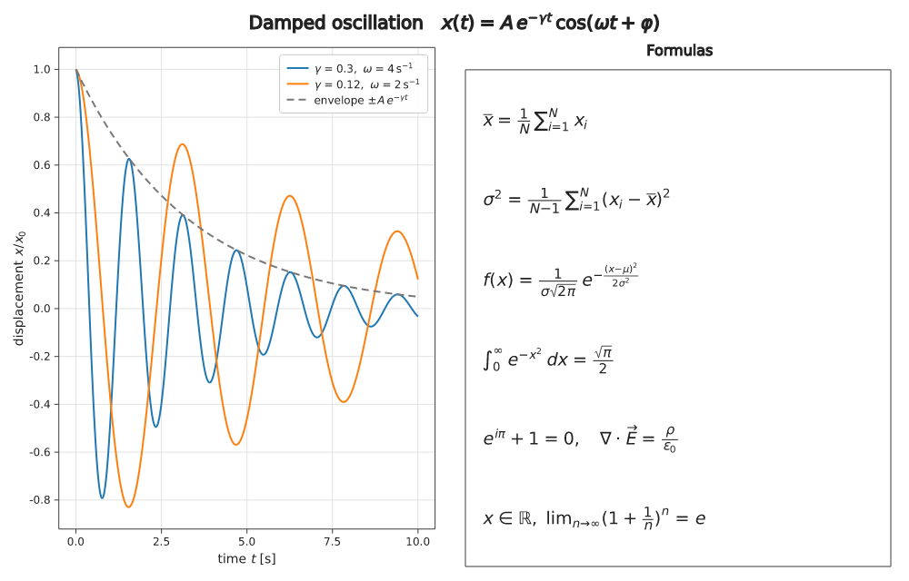

# Math notation

`$...$` in any text (titles, axis labels, legends, annotations) is typeset
from a TeX subset: superscripts and subscripts, fractions, roots, accents,
Greek letters, big operators, function names, `\mathrm`, `\mathbb`, … It is
laid out into ordinary text and lines, so PNG, SVG, PDF and the GPU backend
all show the same result.



```rust
ax.y_label(r"$\sigma^2$ [$\mathrm{m^2\,s^{-2}}$]");
ax.text(0.5, 0.5, r"$\int_0^\infty e^{-x^2}\,dx = \frac{\sqrt{\pi}}{2}$");
```

Built with the [`dataviz::plot`](https://docs.rs/dataviz/latest/dataviz/plot/) API.

## Run

```sh
git clone https://github.com/dataviz-rs/dataviz-examples.git
cd dataviz-examples/plot-math
cargo run --release
```

Writes `math.png` and `math.svg` to the current directory. See
[`src/main.rs`](src/main.rs) for the code.

## License

MIT
