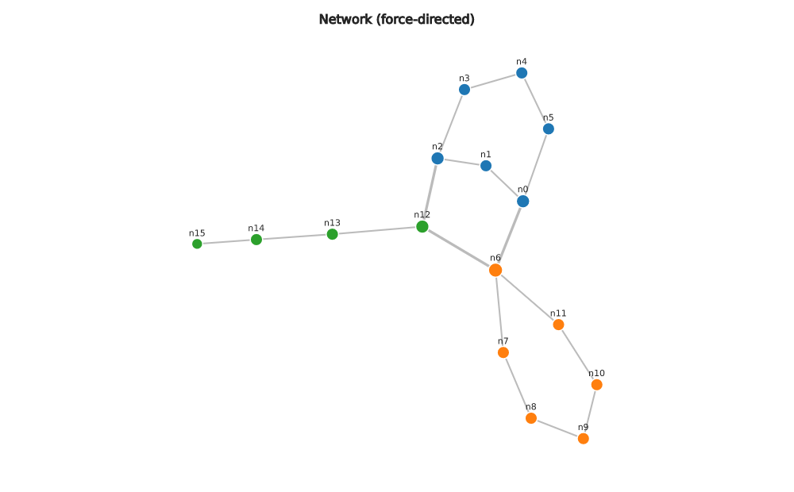
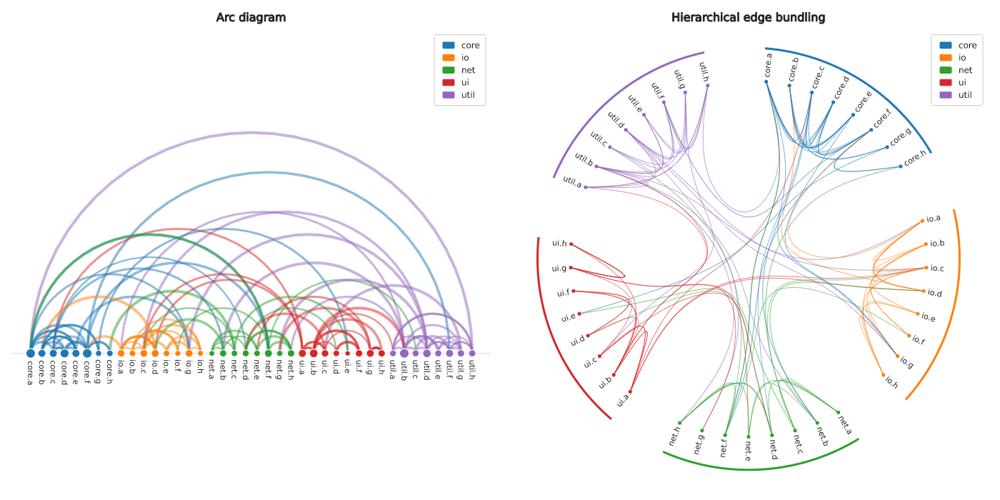

# Network graphs

A force-directed network with node groups, and the imports between the
modules of five packages as an arc diagram and with hierarchical edge
bundling (edges bent through their package, so related links run
together).

Built with the [`dataviz::plot`](https://docs.rs/dataviz/latest/dataviz/plot/) API.





```rust
ax.arc_diagram(&names, edges.clone()).groups(groups.clone()).group_names(packages);
ax.edge_bundling(&names, groups, edges).group_names(packages).tension(0.85);
```

## Run

```sh
git clone https://github.com/dataviz-rs/dataviz-examples.git
cd dataviz-examples/plot-network
cargo run --release
```

Writes `network.png`, `dependencies.png` and their SVGs to the current
directory. See
[`src/main.rs`](src/main.rs) for the code.

## License

MIT
