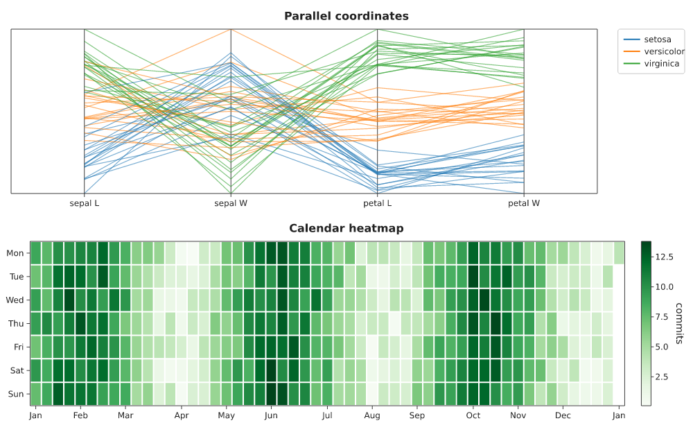

# Parallel coordinates and calendar heatmap

Iris-like data in parallel coordinates and a year of daily values as a calendar.

Built with the [`dataviz::plot`](https://docs.rs/dataviz/latest/dataviz/plot/) API.



## Run

```sh
git clone https://github.com/dataviz-rs/dataviz-examples.git
cd dataviz-examples/plot-parallel-calendar
cargo run --release
```

Writes `parallel_calendar.png` and `parallel_calendar.svg` to the current directory. See
[`src/main.rs`](src/main.rs) for the code.

## License

MIT
