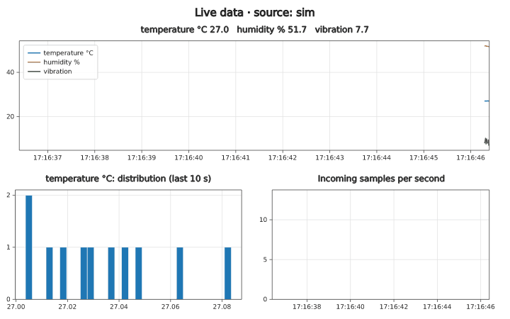

# Live streaming data

A live dashboard for data that keeps arriving: a producer thread sends
samples over a channel, the window takes everything that arrived since the
last frame and redraws (`Figure::show_live`, 30 frames per second).

- top: the last 30 seconds of every channel on a time axis (UTC), latest
  values in the title (`Line::push` + `Line::keep_since`),
- bottom left: distribution of the first channel in that window
  (`Histogram::set_values`),
- bottom right: incoming samples per second.



## Data sources

| Source | Data |
|---|---|
| `sim` (default) | Simulated sensors at 100 Hz: temperature, humidity, vibration with bursts |
| `cpu` | This machine's real CPU and memory use, 10 Hz (Linux, `/proc`) |
| `stdin` | Any numbers piped in, one sample per line (spaces, commas or tabs); a non-numeric first line names the channels |

## Run

```sh
git clone https://github.com/dataviz-rs/dataviz-examples.git
cd dataviz-examples/plot-streaming
cargo run --release                     # simulated sensors
cargo run --release -- cpu              # CPU and memory of this machine
cargo run --release -- sim --window 10  # 10 seconds of history

# real data from another program, e.g. CPU user/system/idle once a second:
vmstat 1 | awk 'BEGIN{print "user system idle"} NR>2{print $13,$14,$15; fflush()}' \
    | cargo run --release -- stdin
```

Without a window (servers, CI) it records an animated GIF and the last frame
as `streaming.png`:

```sh
cargo run --release -- sim --record streaming.gif --seconds 8
```

To stream your own data, replace one of the producer functions in
[`src/main.rs`](src/main.rs) (`simulated`, `system`, `stdin`): anything that
sends `Msg::Sample { t, values }` over the channel works (sockets, serial
ports, message queues, …).

## License

MIT
