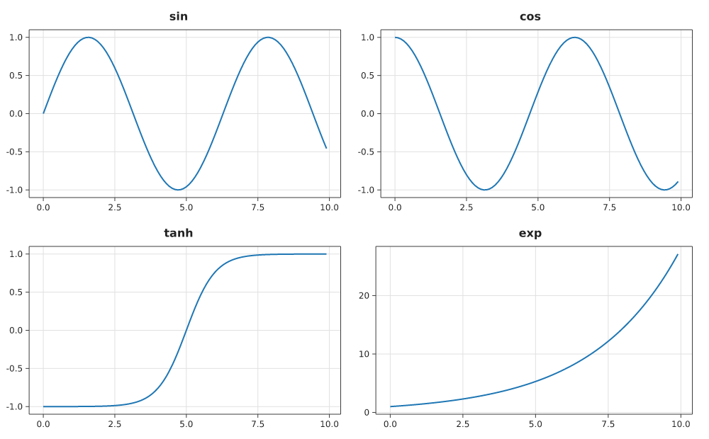

# Subplots with a shared x-axis

A 2 × 2 grid of plots sharing the x limits.

Built with the [`dataviz::plot`](https://docs.rs/dataviz/latest/dataviz/plot/) API.



## Run

```sh
git clone https://github.com/dataviz-rs/dataviz-examples.git
cd dataviz-examples/plot-subplots-shared
cargo run --release
```

Writes `subplots_shared.png` and `subplots_shared.svg` to the current directory. See
[`src/main.rs`](src/main.rs) for the code.

## License

MIT
