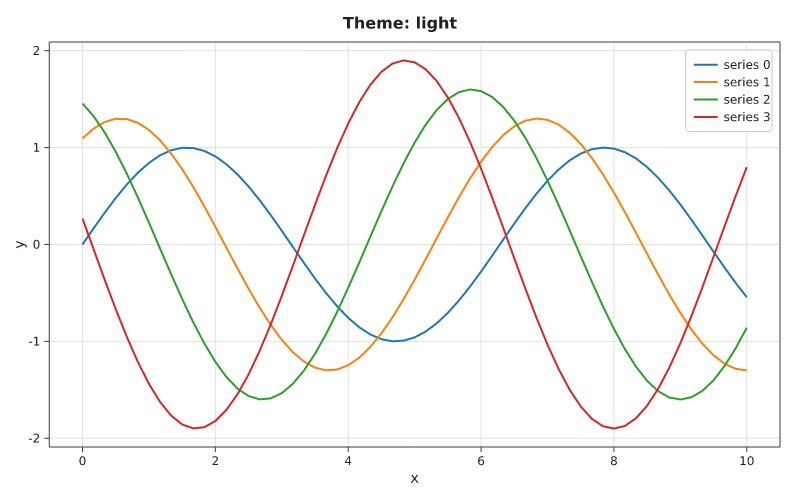
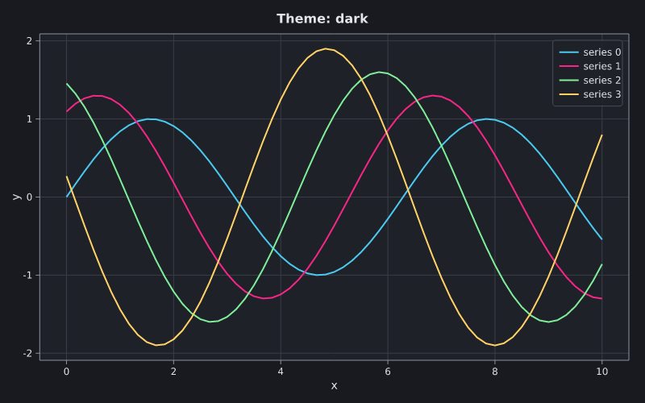
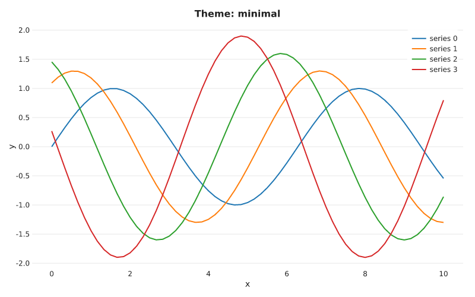
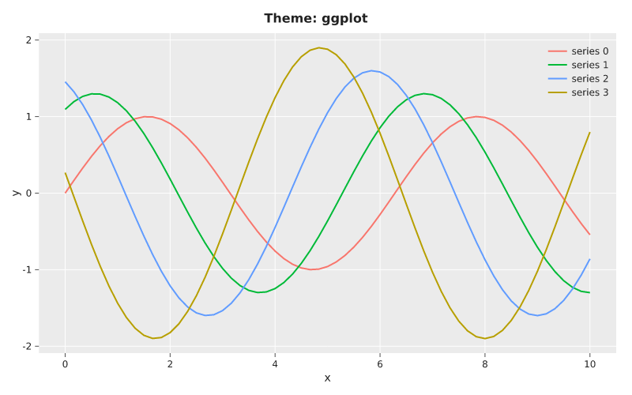
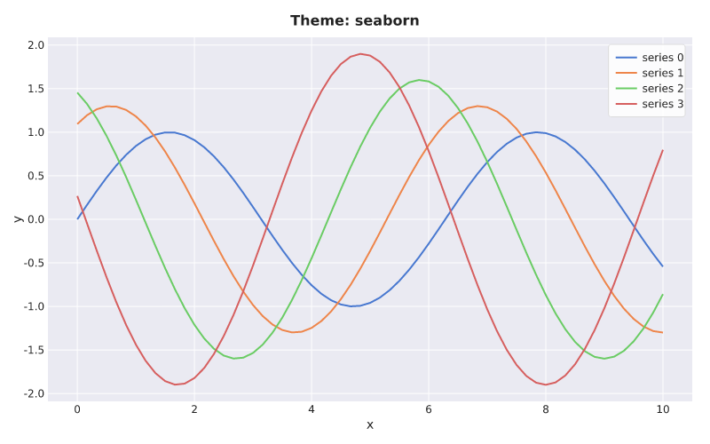
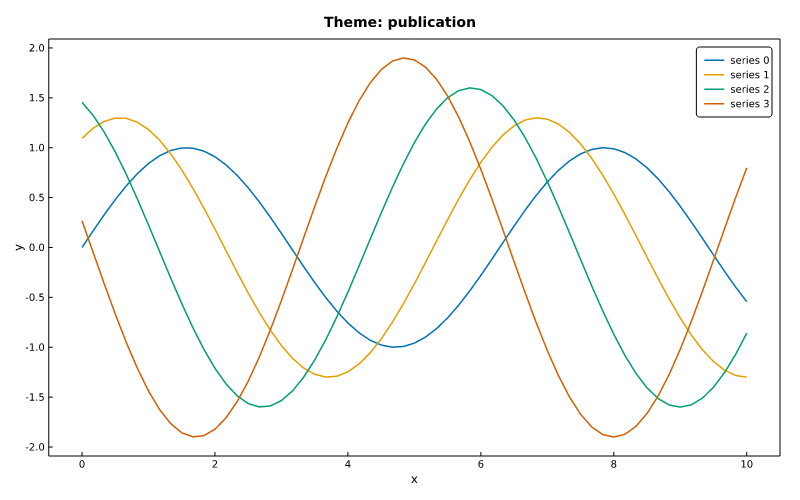
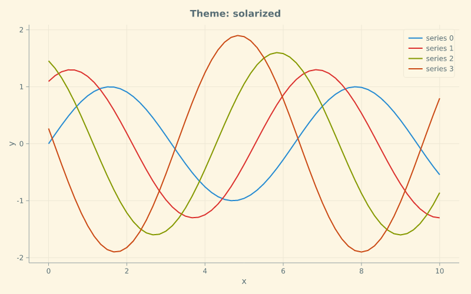

# Themes

The same chart in every built-in theme (`Theme::presets()`).









## Run

```sh
git clone https://github.com/dataviz-rs/dataviz-examples.git
cd dataviz-examples/plot-themes
cargo run --release
```

## License

MIT
