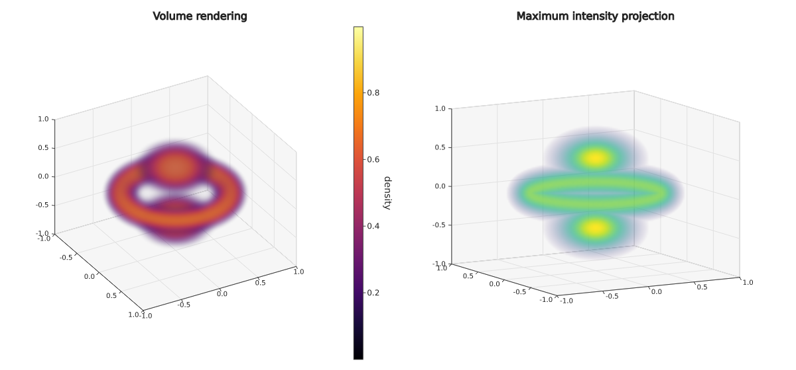

# 3D charts: surface, trajectory, scatter and mesh

A lit surface, the Lorenz attractor as a 3D line colored by time, and
points inside a translucent ellipsoid with perspective. All 3D series of a
plot share one scene (one box, one camera, one depth order), so they hide
each other correctly.


```rust
ax.surface_fn(|x, y| (x * x + y * y).sqrt().sin(), (-8.0, 8.0), (-8.0, 8.0), 60);
ax.line3d(&x, &y, &z).values(&t).colormap(Colormap::Plasma);
ax.scatter3d(&x, &y, &z).values(&z).colormap(Colormap::Turbo);
ax.ellipsoid([0.0, 0.0, 0.0], [3.2, 2.2, 1.7]).opacity(0.2);
ax.camera(-60.0, 30.0).rotate(Axis3::X, 20.0).perspective(0.4);
```

## Volume rendering

A 3D grid of values (densities, CT/MRI scans, simulation fields) seen
through: rays cast through the grid for every pixel, low values
transparent, higher ones glowing in the colormap — or the maximum along
each ray (maximum intensity projection). A 96³ grid draws in about 60 ms.



```rust
ax.volume(values, [nx, ny, nz])            // values[x + nx·(y + ny·z)]
    .extent((-1.0, 1.0), (-1.0, 1.0), (-1.0, 1.0))
    .opacity(0.35)
    .threshold(0.1)
    .colorbar("density");
ax.volume(values, dims).mode(VolumeMode::MaxIntensity);
```

## Turning the scene

The camera turns freely around the x, y and z axes (a rotation matrix, no
gimbal lock): `ax.rotate(Axis3::Y, 30.0)`, `ax.roll(10.0)`,
`ax.camera(azimuth, elevation)` or `ax.set_camera(Camera::principal(&points))`.
In a window (`cargo run --release -- --window`) drag to turn, use the wheel
to zoom, `X`/`Y`/`Z` to rotate by 15° around that axis (Shift+key the
other way) and `R` to reset. GUI and WebAssembly apps do the same with
`fig.pan_by`, `fig.zoom_at` and `fig.rotate_view`.

Built with the [`dataviz::plot`](https://docs.rs/dataviz/latest/dataviz/plot/) API.

## Run

```sh
git clone https://github.com/dataviz-rs/dataviz-examples.git
cd dataviz-examples/plot-three-d
cargo run --release              # three_d.png, three_d.svg
cargo run --release -- --window  # interactive
```

See [`src/main.rs`](src/main.rs) for the code.

## License

MIT
