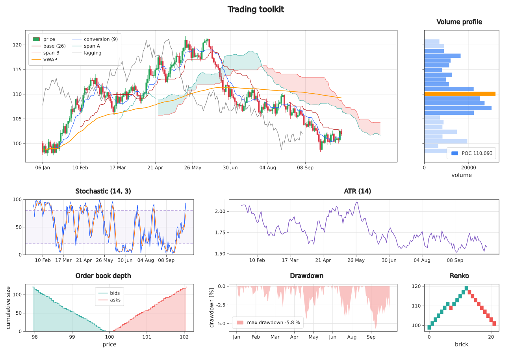

# Charts for traders

Candlesticks on a trading-day axis (no weekend gaps) with the Ichimoku
cloud and VWAP, a volume profile on the same price axis (point of control
and value area), stochastic, ATR, order book depth, drawdown of an equity
curve and a Renko chart. Linked crosshair and zoom work across the panels
in a window.



```rust
let x = ax.trading_axis(&times, "%d %b");
ax.candlestick(&x, &open, &high, &low, &close);
ax.ichimoku(&x, &high, &low, &close);
ax.vwap(&x, &high, &low, &close, &volume);
profile.volume_profile(&close, &volume, 24);
osc.stochastic(&x, &high, &low, &close, 14, 3);
book.depth_chart(&bids, &asks);
dd.drawdown(&x, &equity);
renko.renko(&close, 2.0);
```

Built with the [`dataviz::plot`](https://docs.rs/dataviz/latest/dataviz/plot/) API.

## Run

```sh
git clone https://github.com/dataviz-rs/dataviz-examples.git
cd dataviz-examples/plot-trading
cargo run --release
```

See [`src/main.rs`](src/main.rs) for the code.

## License

MIT
