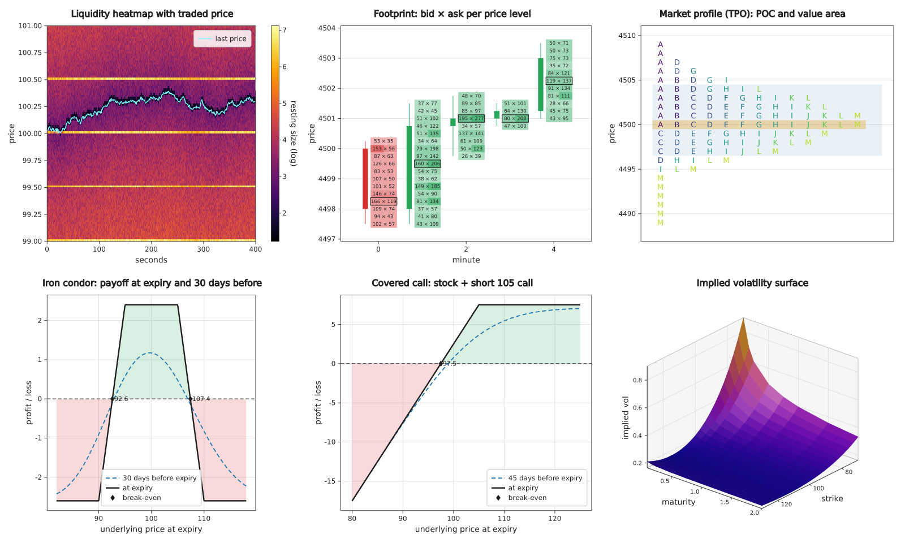

# Charts for traders

Candlesticks on a trading-day axis (no weekend gaps) with the Ichimoku
cloud and VWAP, a volume profile on the same price axis (point of control
and value area), stochastic, ATR, order book depth, drawdown of an equity
curve and a Renko chart. Linked crosshair and zoom work across the panels
in a window.




Order flow and options: an order-book liquidity heatmap with the traded
price, footprint bars (bid × ask per price level, imbalances, point of
control), a market profile (TPO letters, POC, value area), the payoff of an
iron condor and a covered call at expiry and before it (Black–Scholes),
and an implied volatility surface.

```rust
ax.liquidity_heatmap((t0, t1), (p0, p1), &depth);
ax.footprint(bars, 0.25);
ax.market_profile(&half_hour_ranges, 1.0);
ax.option_payoff(&[OptionLeg::Put { strike: 95.0, premium: 2.0, qty: -1.0 }, /* … */], (82.0, 118.0), 30.0, 0.22, 0.03);
ax.volatility_surface(&strikes, &maturities, &iv);
```

```rust
let x = ax.trading_axis(&times, "%d %b");
ax.candlestick(&x, &open, &high, &low, &close);
ax.ichimoku(&x, &high, &low, &close);
ax.vwap(&x, &high, &low, &close, &volume);
profile.volume_profile(&close, &volume, 24);
osc.stochastic(&x, &high, &low, &close, 14, 3);
book.depth_chart(&bids, &asks);
dd.drawdown(&x, &equity);
renko.renko(&close, 2.0);
```

Built with the [`dataviz::plot`](https://docs.rs/dataviz/latest/dataviz/plot/) API.

## Run

```sh
git clone https://github.com/dataviz-rs/dataviz-examples.git
cd dataviz-examples/plot-trading
cargo run --release
```

See [`src/main.rs`](src/main.rs) for the code.

## License

MIT
