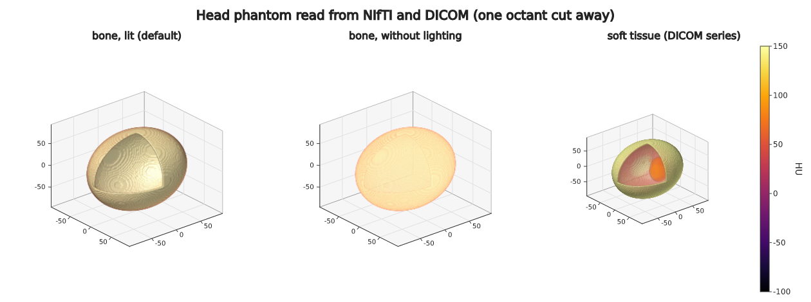

# Volume files: NIfTI, DICOM, VTK, MetaImage

A head phantom (the 3D Shepp–Logan ellipsoids, in Hounsfield-like units,
with one octant cut away) is written as a **NIfTI** file and as a **DICOM
series** of 96 slices, read back with `VolumeData::read` and rendered.



- **Lighting:** the left and middle images differ only in lighting.
  The value gradient gives every surface in the volume diffuse light and
  a highlight, so the cut-away shows its shape. Lighting is on by
  default; `.shading(false)` turns it off.
- **Physical units:** voxel spacing (1.5 mm in plane, 2 mm between
  slices) and the origin come from the files, so the volume keeps its
  proportions.
- **Speed:** both files (128 × 128 × 96 voxels) are read in about 4 ms
  each; the three renderings are saved in about 115 ms.

```rust
use dataviz::plot::volume_file::VolumeData;

let scan = VolumeData::read("head.nii.gz")?;     // .nii .nii.gz .vtk .mhd .mha .dcm, or a DICOM directory
ax.volume_data(&scan)
    .range(-1000.0, 1000.0)                       // bone window (HU)
    .threshold(0.6)
    .colormap(Colormap::Magma);
```

| Format | Read |
|---|---|
| NIfTI-1 and NIfTI-2 (`.nii`, `.nii.gz`) | any data type, either byte order, intensity scaling; for 4D files the first volume |
| DICOM (a directory of slices, or a multi-frame `.dcm`) | sorted along the slice normal, rescale slope and intercept applied; uncompressed transfer syntaxes |
| VTK legacy structured points (`.vtk`) | ASCII or binary, the first scalar array |
| MetaImage (`.mhd` + raw, `.mha`) | plain or zlib-compressed |

In Python: `ax.volume("head.nii.gz")`. In a JSON spec:
`{"type": "volume", "path": "scans/ct/"}`.

## Run

```sh
git clone https://github.com/dataviz-rs/dataviz-examples.git
cd dataviz-examples/plot-volume-files
cargo run --release
```

Writes `volume_files.png`, `out/head.nii` and `out/dicom/IM*.dcm`. See [`src/main.rs`](src/main.rs) for the
code.

## License

MIT
