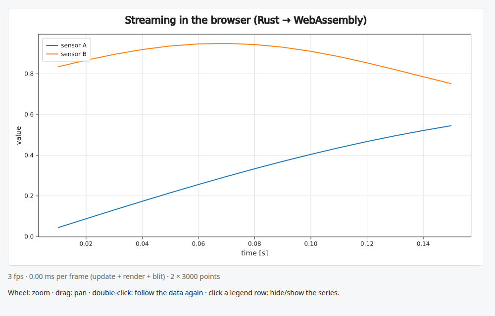

# dataviz in the browser (WebAssembly)

The chart is rendered by Rust compiled to WebAssembly into an RGBA buffer
that a few lines of JavaScript put on a `<canvas>`. Two sensors stream in
every frame; the wheel zooms, dragging pans, a double-click follows the
data again, hovering shows the nearest value and clicking a legend row
hides or shows a series — all handled by dataviz in Rust.



No wasm-bindgen or other JavaScript tooling: the module exports plain
functions (`init`, `step`, `render`, `wheel`, `drag`, `reset`, `click`,
`hover`) and imports nothing. Release build: 3.1 MB (1.2 MB gzipped, the
embedded font and text shaping included); a frame (new data + render at
960×520 with 2 × 3000 points) takes about 1.7 ms in V8.

The interaction calls (`Figure::zoom_at`, `pan_by`, `zoom_to_box`,
`reset_view`, `hover`, `click`) are the same for any GUI toolkit that
shows the figure's pixels (`Figure::render_into`).

## Run

```sh
git clone https://github.com/dataviz-rs/dataviz-examples.git
cd dataviz-examples/plot-wasm
./build.sh        # builds www/plot_wasm.wasm and serves http://127.0.0.1:8000
```

See [`src/lib.rs`](src/lib.rs) and [`www/index.html`](www/index.html).

## License

MIT
