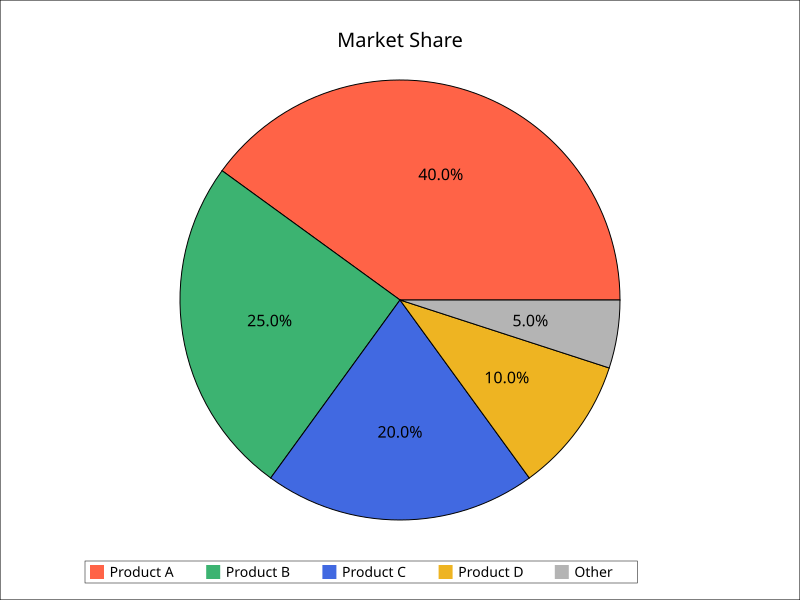

# SVG Pie Chart

Pie chart with percentage labels and a legend, rendered as SVG.

## Features

- Uses [dataviz](https://crates.io/crates/dataviz) 0.1.10+
- Customizable colors, fonts, sizes, tick and grid counts through `FigureConfig`
- No font file needed: an installed sans-serif font is used by default

## Screenshots



## Installation

1. Clone the repository:
    ```sh
    git clone https://github.com/dataviz-rs/dataviz-examples.git
    ```
2. Navigate to the project directory:
    ```sh
    cd dataviz-examples/svgpiechart
    ```
3. Build the project:
    ```sh
    cargo build
    ```

## Usage

Run the application:
```sh
cargo run
```

The output is written to the current directory: `pie_chart.svg`.

## Contributing

Contributions are welcome! Please open an issue or submit a pull request.

## License

This project is licensed under the MIT License.
